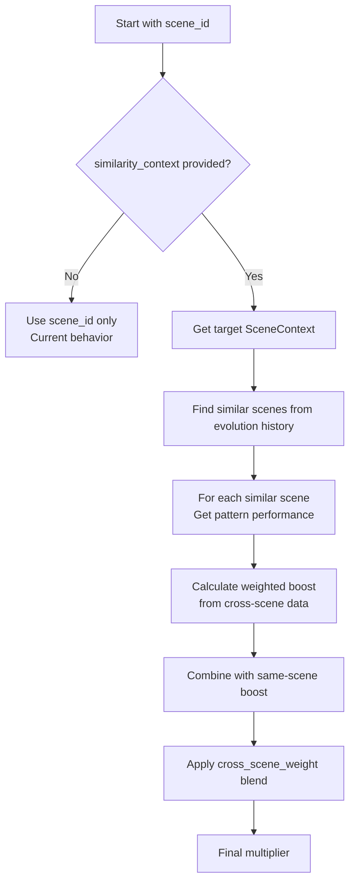
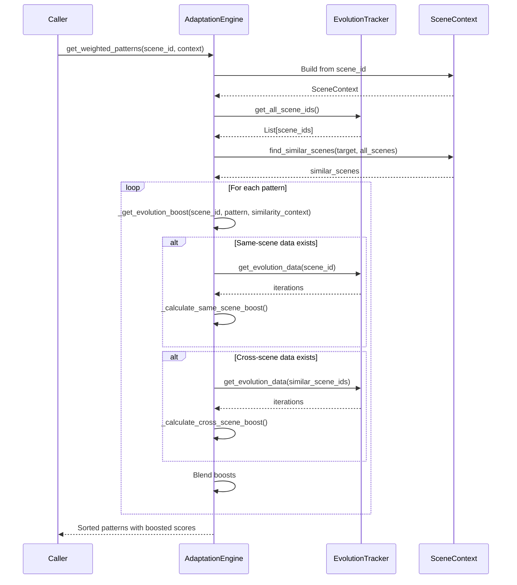

# Cross-Scene Pattern Reuse Enhancement Plan

## Context

The current `_get_evolution_boost()` method in `adaptation.py` only looks at pattern performance within the **same scene_id**. This limits pattern reuse to scenarios where the exact same scene is iterated multiple times.

**Goal**: Enable cross-scene pattern reuse by finding patterns that worked well in **similar scenes** and boosting their weight accordingly.

---

## 1. Context Model Schema

### 1.1 Enhanced SceneContext Dataclass

Add to `scene_evolution.py`:

```python
@dataclass
class SceneContext:
    """Structured context for cross-scene similarity matching.
    
    This captures the semantic attributes of a scene that influence
    whether a pattern will be effective.
    """
    scene_id: str
    scene_type: str = ""      # INT, EXT, INT/EXT
    emotion: str = ""         # tense, dramatic, mysterious, action, calm
    genre: str = ""           # noir, horror, action, romance, comedy
    visual_goal: str = ""     # dark, bright, moody, dynamic, ethereal
    emotional_goal: str = ""  # tension, joy, sadness, suspense, wonder
    time_of_day: str = ""     # day, night, dawn, dusk, golden_hour
    # Extended fields for better similarity
    location_type: str = ""   # urban, rural, indoor, outdoor, enclosed
    pacing: str = ""          # slow, medium, fast
    lighting_quality: str = "" # natural, artificial, mixed, dramatic
    color_palette: str = ""   # warm, cool, neutral, high_contrast, desaturated
    
    def to_vector(self) -> List[float]:
        """Convert to numeric vector for similarity calculation."""
        # Returns ordered list of field values encoded as floats
        pass
    
    def to_tag_set(self) -> Set[str]:
        """Convert to set of non-empty tags for Jaccard similarity."""
        tags = set()
        for field in ['scene_type', 'emotion', 'genre', 'visual_goal', 
                      'emotional_goal', 'time_of_day', 'location_type', 
                      'pacing', 'lighting_quality', 'color_palette']:
            val = getattr(self, field, "")
            if val:
                tags.add(f"{field}:{val.lower()}")
        return tags
```

### 1.2 Context Similarity Weights

| Field | Weight | Rationale |
|-------|--------|-----------|
| emotion | 0.20 | Primary driver of visual/technical choices |
| scene_type | 0.15 | INT vs EXT fundamentally changes camera/lighting |
| visual_goal | 0.15 | Direct influence on pattern effectiveness |
| genre | 0.12 | Style consistency matters |
| emotional_goal | 0.12 | Affects pacing and mood |
| pacing | 0.08 | Moderate influence on camera movement |
| time_of_day | 0.06 | Lighting context |
| location_type | 0.06 | Environment constraints |
| lighting_quality | 0.04 | Minor technical consideration |
| color_palette | 0.02 | Aesthetic preference |

**Total**: 1.0

---

## 2. Context Similarity Scoring

### 2.1 Similarity Calculation Functions

Add to `scene_evolution.py`:

```python
def calculate_context_similarity(ctx1: SceneContext, ctx2: SceneContext) -> float:
    """Calculate similarity between two scene contexts (0.0 to 1.0).
    
    Uses weighted tag matching for categorical fields.
    """
    tags1 = ctx1.to_tag_set()
    tags2 = ctx2.to_tag_set()
    
    if not tags1 or not tags2:
        return 0.0
    
    # Jaccard similarity on tag sets
    intersection = len(tags1 & tags2)
    union = len(tags1 | tags2)
    
    return intersection / union if union > 0 else 0.0


def find_similar_scenes(
    target_context: SceneContext,
    all_scenes: List[SceneContext],
    min_similarity: float = 0.3,
    max_results: int = 10
) -> List[Tuple[str, float]]:
    """Find scenes similar to target, return (scene_id, similarity) pairs.
    
    Args:
        target_context: The scene to find matches for
        all_scenes: List of candidate scene contexts
        min_similarity: Minimum similarity threshold (0.0-1.0)
        max_results: Maximum number of results to return
    
    Returns:
        List of (scene_id, similarity) tuples, sorted by similarity descending
    """
    similarities = []
    for scene in all_scenes:
        if scene.scene_id == target_context.scene_id:
            continue  # Don't match self
        sim = calculate_context_similarity(target_context, scene)
        if sim >= min_similarity:
            similarities.append((scene.scene_id, sim))
    
    similarities.sort(key=lambda x: x[1], reverse=True)
    return similarities[:max_results]
```

### 2.2 Similarity Threshold Strategy

| Threshold | Behavior | Use Case |
|-----------|----------|----------|
| >= 0.8 | Near-identical | Same scene type with minor variations |
| 0.5 - 0.8 | Similar | Different scenes with shared characteristics |
| 0.3 - 0.5 | Loosely related | Cross-genre pattern hints |
| < 0.3 | Ignored | Too dissimilar to be useful |

---

## 3. Integration with Existing Boost/Penalty System

### 3.1 Modified _get_evolution_boost() Signature

```python
def _get_evolution_boost(
    self,
    scene_id: Optional[str],
    pattern_type: str,
    pattern_value: str,
    # NEW PARAMETERS
    similarity_context: Optional[SceneContext] = None,
    cross_scene_weight: float = 0.3,  # How much to weight cross-scene data
    min_similarity: float = 0.3,  # Minimum similarity to consider
) -> float:
```

### 3.2 Boost Calculation Flow



### 3.3 Blended Boost Formula

```python
# Same-scene boost (existing behavior)
same_scene_boost = self._calculate_same_scene_boost(scene_id, pattern_type, pattern_value)

# Cross-scene boost (new)
cross_scene_boost = self._calculate_cross_scene_boost(
    similarity_context, 
    pattern_type, 
    pattern_value,
    min_similarity
)

# Blend based on cross_scene_weight
# If we have strong same-scene data, rely on it more
if same_scene_boost != 1.0:
    # Has same-scene history - use primarily that
    final_boost = (1.0 - cross_scene_weight) * same_scene_boost + cross_scene_weight * cross_scene_boost
else:
    # No same-scene history - rely on cross-scene
    final_boost = cross_scene_boost
```

### 3.4 Cross-Scene Boost Calculation

```python
def _calculate_cross_scene_boost(
    self,
    context: SceneContext,
    pattern_type: str,
    pattern_value: str,
    min_similarity: float
) -> float:
    """Calculate boost based on pattern performance in similar scenes."""
    
    # Get all scenes with evolution data
    all_scene_ids = evolution_tracker.get_all_scene_ids()
    
    # Build scene contexts for all scenes
    all_contexts = []
    for sid in all_scene_ids:
        ctx = self._build_scene_context(sid)
        if ctx:
            all_contexts.append(ctx)
    
    # Find similar scenes
    similar_scenes = find_similar_scenes(context, all_contexts, min_similarity)
    
    if not similar_scenes:
        return 1.0  # No similar scenes found
    
    # Aggregate pattern performance from similar scenes
    weighted_quality_sum = 0.0
    weighted_alignment_sum = 0.0
    total_weight = 0.0
    
    for similar_scene_id, similarity_score in similar_scenes:
        # Get pattern performance in this scene
        perf = self._get_pattern_performance_in_scene(
            similar_scene_id, pattern_type, pattern_value
        )
        if perf:
            # Weight by similarity (more similar = more influence)
            weight = similarity_score
            weighted_quality_sum += perf['quality'] * weight
            weighted_alignment_sum += perf['alignment'] * weight
            total_weight += weight
    
    if total_weight == 0:
        return 1.0
    
    avg_quality = weighted_quality_sum / total_weight
    avg_alignment = weighted_alignment_sum / total_weight
    
    # Convert to boost using same formula as same-scene
    return self._quality_alignment_to_boost(avg_quality, avg_alignment)
```

---

## 4. Safeguards and Fallbacks

### 4.1 Safety Checks

| Check | Behavior on Failure |
|-------|---------------------|
| Empty similarity_context | Fall back to same-scene only |
| No similar scenes found | Return boost = 1.0 (no change) |
| All similar scenes have no pattern data | Return boost = 1.0 |
| Exception during calculation | Log warning, return 1.0 |
| similarity_score < min_similarity | Exclude from calculation |

### 4.2 Fallback Hierarchy

1. **Same-scene data exists** → Use primarily same-scene with cross-scene辅助
2. **No same-scene, cross-scene exists** → Use cross-scene boost
3. **Neither exists** → Return 1.0 (no boost)

### 4.3 Performance Guards

- Cache similar scene lookups (invalidate on new iteration)
- Limit cross-scene search to scenes with evolution data
- Maximum 20 similar scenes to consider per boost calculation
- Similarity calculation must complete in < 10ms

---

## 5. Constants and Weights

### 5.1 New Configuration Constants

```python
# In AdaptationEngine class
_CROSS_SCENE_WEIGHT = 0.3  # How much cross-scene data influences boost (0.0-1.0)
_MIN_SIMILARITY_THRESHOLD = 0.3  # Minimum similarity to consider a scene
_MAX_SIMILAR_SCENES = 20  # Maximum similar scenes to consider
_SIMILARITY_CACHE_TTL = 300  # Cache TTL in seconds (5 minutes)
```

### 5.2 Context Field Weights (for similarity)

```python
CONTEXT_FIELD_WEIGHTS = {
    'emotion': 0.20,
    'scene_type': 0.15,
    'visual_goal': 0.15,
    'genre': 0.12,
    'emotional_goal': 0.12,
    'pacing': 0.08,
    'time_of_day': 0.06,
    'location_type': 0.06,
    'lighting_quality': 0.04,
    'color_palette': 0.02,
}
```

### 5.3 Boost Blending Weights

```python
# When same-scene data exists
SAME_SCENE_BLEND = 0.7  # 70% same-scene, 30% cross-scene
CROSS_SCENE_BLEND = 0.3

# When only cross-scene data exists
ONLY_CROSS_SCENE_BOOST_FLOOR = 0.85  # Don't boost too much without direct evidence
ONLY_CROSS_SCENE_BOOST_CEILING = 1.15
```

---

## 6. Test Cases

### 6.1 Unit Tests

| Test | Description |
|------|-------------|
| `test_context_similarity_identical` | Two identical contexts return 1.0 |
| `test_context_similarity_completely_different` | Two unrelated contexts return ~0.0 |
| `test_context_similarity_partial_match` | Partial overlap returns intermediate value |
| `test_find_similar_scenes_excludes_self` | Target scene not in results |
| `test_find_similar_scenes_respects_threshold` | Results below threshold excluded |
| `test_find_similar_scenes_respects_max_results` | Returns at most max_results |
| `test_cross_scene_boost_no_similar_scenes` | Returns 1.0 when no matches |
| `test_cross_scene_boost_with_matches` | Returns weighted boost |
| `test_boost_blending_with_same_scene_data` | Blends correctly |
| `test_boost_blending_without_same_scene_data` | Uses cross-scene only |

### 6.2 Integration Tests

| Test | Description |
|------|-------------|
| `test_pattern_boosted_from_similar_scene` | Pattern used in similar INT scene gets boost |
| `test_pattern_not_boosted_from_dissimilar_scene` | Pattern from very different scene not boosted |
| `test_evolution_boost_falls_back_gracefully` | Handles missing data gracefully |

### 6.3 Edge Cases

- Empty SceneContext fields
- All scenes have no evolution data
- SceneContext with only some fields populated
- Very high similarity (0.95+) should not over-boost
- Zero similarity scenes should be excluded

---

## 7. Implementation Phases

### Phase 1: Core Infrastructure
- [ ] Add `SceneContext` dataclass to `scene_evolution.py`
- [ ] Implement `to_tag_set()` and `to_vector()` methods
- [ ] Add `calculate_context_similarity()` function
- [ ] Add `find_similar_scenes()` function
- [ ] Add unit tests for similarity functions

### Phase 2: Cross-Scene Boost Calculation
- [ ] Add `_calculate_cross_scene_boost()` method to `AdaptationEngine`
- [ ] Add `_build_scene_context()` helper method
- [ ] Add `_get_pattern_performance_in_scene()` helper method
- [ ] Add configuration constants
- [ ] Add unit tests for cross-scene boost

### Phase 3: Integration
- [ ] Modify `_get_evolution_boost()` signature to accept `similarity_context`
- [ ] Implement boost blending logic
- [ ] Add caching for similar scene lookups
- [ ] Add integration tests

### Phase 4: Polish
- [ ] Update `get_weighted_patterns()` to pass context when available
- [ ] Add logging for cross-scene boost decisions
- [ ] Performance optimization pass
- [ ] Update documentation

---

## 8. Data Flow (Updated)



---

## 9. Backward Compatibility

- `_get_evolution_boost()` signature change: `similarity_context=None` default maintains existing behavior
- No changes to stored evolution data format
- Pattern storage and retrieval unchanged
- Existing tests continue to pass (with default parameters)

---

## 10. Performance Considerations

| Operation | Current | With Cross-Scene |
|-----------|---------|------------------|
| _get_evolution_boost | O(n) iterations | O(n) + O(m log m) similarity |
| get_weighted_patterns | O(p log p) | O(p log p) + O(s) |
| Memory | Unchanged | +O(s) for context cache |

Where:
- n = iterations per scene
- p = patterns per type
- s = scenes with evolution data

**Mitigation**: Cache similar scene lookups, limit max similar scenes to 20.