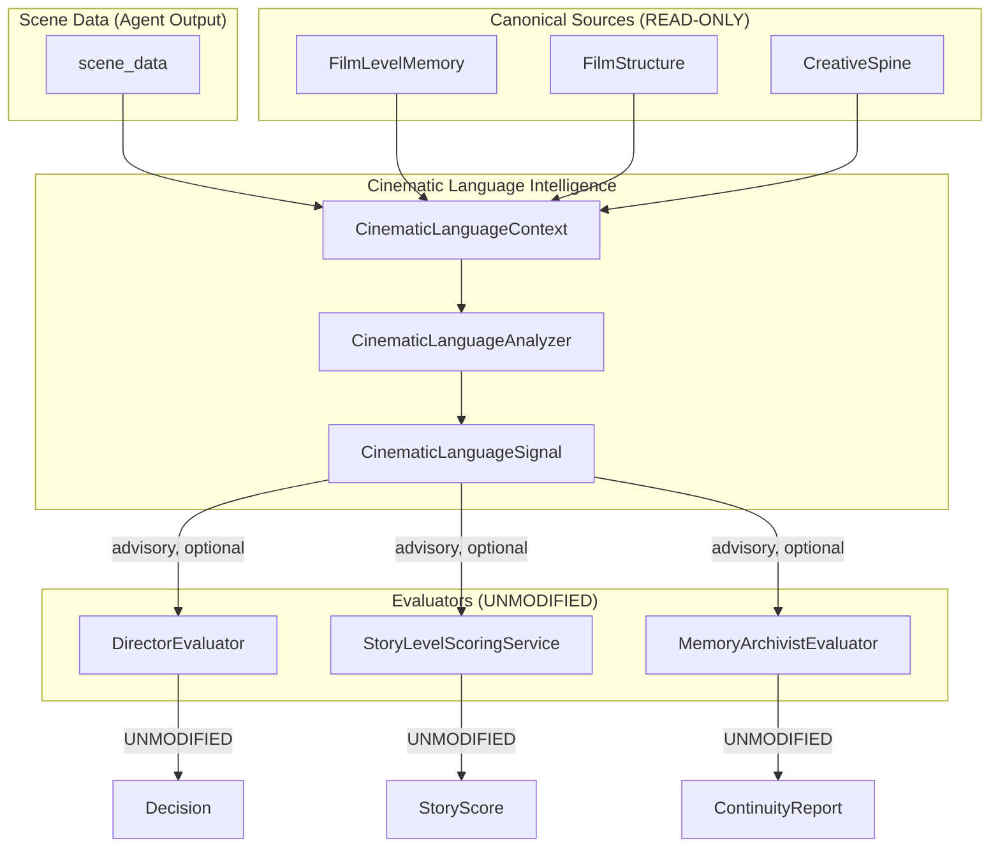

# Phase 8: Cinematic Language Intelligence - Architecture Plan

## Executive Summary

Phase 8 adds a new additive service that evaluates **visual storytelling as meaning**, not just style. The system currently evaluates visuals heuristically (generic vs. specific, neutral vs. motivated) but lacks semantic understanding of what visual choices communicate.

**Core Principle**: Cinematic Language Intelligence is **derived, advisory, and bounded**. It reads existing canonical data (scene_data, film_memory, film_structure) and produces interpretive signals that can be consumed by DirectorEvaluator. It does NOT introduce new canonical truth, does NOT modify existing evaluators, and does NOT change scoring thresholds.

**Key Distinction**: The existing `generic_visuals` rejection rule in DirectorEvaluator detects "bad" visual language. Phase 8 adds the ability to understand "what does this visual choice mean?" - framing semantics, camera movement significance, motif evolution in visuals, and dialogue-to-visual substitution opportunities.

---

## 1. Cinematic Language Responsibilities

### 1.1 What Cinematic Language Intelligence Evaluates

| Dimension | Description | Grounded In | Heuristic Output |
|-----------|-------------|-------------|------------------|
| **Visual Intent Detection** | Is there clear purpose behind visual choices? | `visual_description`, `camera_work`, `lighting` text | Inferred intent category (narrative/emotional/thematic) |
| **Framing Semantics** | What do framing choices communicate about power/isolation/relationship? | `visual_description` (character positions, shot types) | Inferred framing meaning (dominant/submissive/isolated/connected) |
| **Camera Movement Meaning** | What does camera movement vs. stillness communicate? | `camera_work` text | Inferred movement significance (stability/chaos/intimacy/observation) |
| **Motif Evolution in Visuals** | How do visual motifs evolve and accumulate meaning? | `film_memory.motifs`, current `visual_description` | Motif evolution stage (introduction/development/payoff) |
| **Restraint vs. Over-Direction** | Is visual language restrained (meaningful) or over-directed (distracting)? | `camera_work`, `visual_description` density | Restraint score (0.0-1.0) |
| **Dialogue-to-Visual Substitution** | Could visual storytelling replace or reduce dialogue? | `dialogue` length, `visual_description` richness, `actions` | Substitution opportunity score (0.0-1.0) |

### 1.2 What Cinematic Language Intelligence Does NOT Do

- Does NOT evaluate technical quality (DirectorEvaluator responsibility)
- Does NOT audit continuity consistency (MemoryArchivistEvaluator responsibility)
- Does NOT score story-level health (StoryLevelScoringService responsibility)
- Does NOT make APPROVE/REVISE/REJECT decisions (Director authority)
- Does NOT modify FilmLevelMemory or FilmStructure (canonical sources)
- Does NOT introduce new canonical film state
- Does NOT change existing scoring thresholds

### 1.3 Data Access Boundaries

All inputs are **read from existing canonical sources**:

```
CinematicLanguageAnalyzer
├── scene_data (from agent output)
│   ├── visual_description: str
│   ├── camera_work: str
│   ├── lighting: str
│   ├── dialogue: str
│   ├── actions: str
│   └── tone: str
├── film_memory (from FilmLevelMemory)
│   ├── motifs: List[MotifRecord]
│   ├── visual_philosophy: str
│   └── restraint_rules: List[Dict]
├── film_structure (from FilmStructure)
│   ├── acts, sequences, scenes
│   └── themes: List[str]
└── spine (from CreativeSpine)
    ├── visual_philosophy: str
    └── constraint_weights: Dict
```

---

## 2. System Additions

### 2.1 New Models

**File**: `studio-backend/app/models/cinematic_language.py`

```python
@dataclass
class CinematicLanguageSignal:
    """
    Advisory signal from Cinematic Language Intelligence.
    
    This is a READ-ONLY derived output. It does not modify any canonical state.
    All fields are labeled as grounded or heuristic.
    """
    # Identity
    scene_id: str
    film_id: str
    
    # Grounded inputs (what was observed)
    observed_visual_description: str
    observed_camera_work: str
    observed_lighting: str
    
    # Heuristic outputs (interpreted meaning)
    visual_intent_category: str  # "narrative" | "emotional" | "thematic" | "none_detected"
    visual_intent_confidence: float  # 0.0-1.0
    
    framing_meaning: str  # "dominant" | "submissive" | "isolated" | "connected" | "neutral"
    framing_confidence: float  # 0.0-1.0
    
    movement_significance: str  # "stability" | "chaos" | "intimacy" | "observation" | "none"
    movement_confidence: float  # 0.0-1.0
    
    restraint_score: float  # 0.0-1.0 (higher = more restrained)
    restraint_indicators: List[str]  # debug: what was found
    
    dialogue_substitution_opportunity: float  # 0.0-1.0
    substitution_indicators: List[str]  # debug: what was found
    
    # Motif evolution (partially grounded - uses film_memory.motifs)
    motif_evolution_stage: str  # "introduction" | "development" | "reinforcement" | "payoff" | "none"
    motif_evolution_confidence: float  # 0.0-1.0
    detected_motif_references: List[str]  # motif_ids found in visuals
    
    # Debug metadata
    analysis_method: str  # "keyword_matching" | "pattern_analysis" | "combined"
    timestamp: str


@dataclass  
class CinematicLanguageContext:
    """
    Context bundle for cinematic language analysis.
    
    This is a read-only pass-through that packages existing canonical data
    for the analyzer. No new truth is created here.
    """
    scene_data: Dict[str, Any]
    film_memory: Optional[FilmLevelMemory]
    film_structure: Optional[FilmStructure]
    spine: Optional[CreativeSpine]
```

### 2.2 New Service

**File**: `studio-backend/app/services/cinematic_language_service.py`

```python
class CinematicLanguageAnalyzer:
    """
    Analyzes visual storytelling as meaning, not just style.
    
    This is a READ-ONLY derived service. It reads existing canonical data
    and produces interpretive signals. It does NOT:
    - Modify FilmLevelMemory or FilmStructure
    - Change scoring thresholds in DirectorEvaluator
    - Introduce new canonical truth
    - Override or bypass existing evaluators
    
    Usage:
        analyzer = CinematicLanguageAnalyzer()
        context = CinematicLanguageContext(
            scene_data=scene_data,
            film_memory=film_memory,
            film_structure=film_structure,
            spine=spine
        )
        signal = analyzer.analyze(context)
    """
    
    # Keyword dictionaries for grounded analysis
    VISUAL_INTENT_MARKERS = {
        "narrative": ["reveals", "exposes", "uncovers", "shows us", "we see"],
        "emotional": ["emphasizes", "highlights", "focuses on", "dwells on"],
        "thematic": ["symbolizes", "represents", "embodies", "mirrors"]
    }
    
    FRAMING_MARKERS = {
        "dominant": ["above", "overlooking", "looking down", "higher angle"],
        "submissive": ["below", "looking up", "lower angle", "beneath"],
        "isolated": ["alone", "separated", "apart", "distant", "alone in frame"],
        "connected": ["together", "facing each other", "alongside", "paired"]
    }
    
    MOVEMENT_MARKERS = {
        "stability": ["static", "locked off", "still", "stationary"],
        "chaos": ["shaky", "handheld", "erratic", "rapid pans"],
        "intimacy": ["dolly in", "tracking toward", "push in", "close"],
        "observation": ["slow pan", "slow track", "establishing", "wide"]
    }
    
    RESTRAINT_POSITIVE_MARKERS = [
        "single shot", "one take", "static frame", "held", 
        "without cutting", "long take", "minimal", "restrained"
    ]
    
    RESTRAINT_NEGATIVE_MARKERS = [
        "constant", "every angle", "coverage", "shot reverse shot",
        "multiple angles", "rapid cutting", "excessive"
    ]
    
    def analyze(self, context: CinematicLanguageContext) -> CinematicLanguageSignal:
        """
        Perform cinematic language analysis on scene data.
        
        All analysis is derived from existing data. No new canonical state is created.
        """
        pass  # Implementation in Phase 8.1
    
    def _detect_visual_intent(self, scene_data: Dict) -> Tuple[str, float]:
        """Detect visual intent category from visual_description and camera_work."""
        pass
    
    def _detect_framing_meaning(self, scene_data: Dict) -> Tuple[str, float]:
        """Detect framing semantics (power, isolation, relationship)."""
        pass
    
    def _detect_movement_significance(self, camera_work: str) -> Tuple[str, float]:
        """Detect camera movement vs. stillness meaning."""
        pass
    
    def _score_restraint(self, scene_data: Dict) -> Tuple[float, List[str]]:
        """Score visual restraint vs. over-direction."""
        pass
    
    def _detect_dialogue_substitution_opportunity(self, scene_data: Dict) -> Tuple[float, List[str]]:
        """Detect if visual storytelling could replace dialogue."""
        pass
    
    def _track_motif_evolution(
        self, 
        scene_data: Dict, 
        film_memory: Optional[FilmLevelMemory]
    ) -> Tuple[str, float, List[str]]:
        """Track how visual motifs evolve across the film."""
        pass
```

### 2.3 What is NOT Added

- No new canonical models (FilmLevelMemory, FilmStructure, CreativeSpine remain canonical)
- No new services that modify state
- No changes to existing evaluator thresholds
- No new memory or continuity tracking

---

## 3. Integration Strategy

### 3.1 Integration with DirectorEvaluator (PRIMARY)

**Integration Pattern**: DirectorEvaluator reads CinematicLanguageSignal as advisory input.

```
DirectorEvaluator.evaluate()
├── scene_data, spine, structure, memory
├── [NEW] cinematic_language_signal: Optional[CinematicLanguageSignal] = NULL
│
├── _check_instant_rejection()  # UNCHANGED
│
├── _calculate_scores()  # UNCHANGED
│   ├── _score_intent_alignment()  # UNCHANGED
│   ├── _score_emotional_consistency()  # UNCHANGED
│   ├── _score_visual_coherence()  # CAN incorporate signal if available
│   └── _score_continuity()  # UNCHANGED
│
└── [NEW] _apply_cinematic_language_context(signal)
    └── Adds signal to quality_metrics for debug visibility
        Does NOT change scores unless signal indicates "none_detected" intent
```

**Bounded Integration Rules**:
1. CinematicLanguageSignal is **optional** - DirectorEvaluator works without it
2. Signal is attached to `quality_metrics` for debug visibility
3. Signal does NOT change DirectorEvaluator thresholds
4. Signal does NOT bypass instant rejection rules
5. Signal does NOT override scene decision

### 3.2 Integration with StoryLevelScoringService (SECONDARY)

**Integration Pattern**: StoryLevelScoringService reads CinematicLanguageSignal for advisory context.

```
StoryLevelScoringService.score_scene()
├── film_id, scene_id, scene_data, context
├── [NEW] cinematic_language_signal: Optional[CinematicLanguageSignal] = NULL
│
└── Uses signal for advisory recommendations only
    - Does NOT change story scores
    - Does NOT affect thesis alignment scoring
    - Signal attached to debug_metadata in recommendations
```

### 3.3 Integration with MemoryArchivistEvaluator (MOTIF-AWARE)

**Integration Pattern**: MemoryArchivistEvaluator motif tracking enhanced by CinematicLanguageAnalyzer motif evolution detection.

```
MemoryArchivistEvaluator.evaluate_scene_continuity()
├── scene_data, film_id, structure, memory
├── [NEW] motif_evolution_context: Optional[CinematicLanguageSignal] = NULL
│
└── Uses signal.motif_evolution_stage for motif callback analysis
    - Does NOT change continuity alerts
    - Does NOT modify FilmLevelMemory
    - Signal attached to debug_metadata in reports
```

### 3.4 Integration Diagram



---

## 4. Grounded vs. Heuristic Breakdown

### 4.1 Grounded Inputs (What the system actually has access to)

| Input | Source | Access |
|-------|--------|--------|
| `visual_description` | scene_data from agent | Direct text access |
| `camera_work` | scene_data from agent | Direct text access |
| `lighting` | scene_data from agent | Direct text access |
| `dialogue` | scene_data from agent | Direct text access |
| `actions` | scene_data from agent | Direct text access |
| `motifs` | film_memory.motifs | MotifRecord list with names, types, recurrences |
| `visual_philosophy` | film_memory.visual_philosophy | String description |
| `restraint_rules` | film_memory.restraint_rules | List of Dict with rule text |
| `themes` | film_structure.themes | String list |

### 4.2 Heuristic Outputs (Inferred meaning with confidence)

| Output | Heuristic Method | Bounding |
|--------|------------------|----------|
| `visual_intent_category` | Keyword matching in visual_description | Returns "none_detected" if confidence < 0.5 |
| `framing_meaning` | Keyword matching for power/isolation/relationship markers | Returns "neutral" if no markers found |
| `movement_significance` | Keyword matching in camera_work | Returns "none" if camera_work is empty |
| `restraint_score` | Marker counting (positive - negative) | Clamped to 0.0-1.0 |
| `dialogue_substitution_opportunity` | Ratio of dialogue length to visual_description richness | Returns 0.0 if dialogue < 100 chars |
| `motif_evolution_stage` | Cross-reference visual_description with film_memory.motifs | Returns "none" if no motifs in film_memory |

### 4.3 Confidence Scoring

All heuristic outputs include a confidence score (0.0-1.0):

- **High confidence (0.8-1.0)**: Multiple strong markers found
- **Medium confidence (0.5-0.79)**: Some markers found, interpretation is plausible
- **Low confidence (0.0-0.49)**: Few or ambiguous markers, conservative interpretation

Consumers should treat low-confidence signals as advisory only.

---

## 5. Safety Constraints

### 5.1 No Duplicate Sources of Truth

- CinematicLanguageAnalyzer does NOT write to FilmLevelMemory
- CinematicLanguageAnalyzer does NOT modify FilmStructure
- All signals are derived and ephemeral (not persisted)
- Canonical truth remains: FilmLevelMemory, FilmStructure, CreativeSpine

### 5.2 No Hidden Threshold Mutation

- DirectorEvaluator thresholds (0.80/0.60) remain unchanged
- StoryLevelScoringService thresholds remain unchanged
- CinematicLanguageSignal does NOT directly modify any scores
- Signal is advisory only, attached for visibility

### 5.3 No Uncontrolled Scoring Changes

- Any score influence from CinematicLanguageSignal must be:
  1. Explicitly coded in DirectorEvaluator
  2. Bounded by MAX_TASTE_SCORE_DELTA (0.05) similar guard
  3. Debug-visible in quality_metrics
  4. Documented in integration test

### 5.4 Additive-Only Architecture

- New files only: `models/cinematic_language.py`, `services/cinematic_language_service.py`
- No modifications to existing services
- No modifications to existing models
- No changes to existing tests

### 5.5 Debug-Visible Influence

Every CinematicLanguageSignal includes:
- `analysis_method`: How the analysis was performed
- `timestamp`: When analysis occurred
- `confidence`: How certain the interpretation is
- `indicators`: What specific markers were found

This ensures any future integration can be audited and understood.

---

## 6. Implementation Plan

### Phase 8.1: Foundation (Models + Service)

**Files Created**:
- `studio-backend/app/models/cinematic_language.py`
- `studio-backend/app/services/cinematic_language_service.py`
- `studio-backend/app/services/test_cinematic_language_service.py`

**Scope**:
- Define CinematicLanguageSignal and CinematicLanguageContext models
- Implement CinematicLanguageAnalyzer with all analysis methods
- All methods return placeholder conservative values (0.5 confidence)
- No integration with DirectorEvaluator

**Tests**:
- Model validation tests
- Service instantiation tests
- Each analysis method returns expected structure

**Exit Criteria**:
- [ ] Models import correctly
- [ ] Service instantiates without errors
- [ ] All analysis methods return valid signal structure
- [ ] Tests pass

---

### Phase 8.2: Read-Only Exposure

**Files Modified**: None (read-only exposure means adding methods, not changing behavior)

**Scope**:
- Add `analyze_scene(scene_data, film_memory, film_structure, spine)` method to CinematicLanguageAnalyzer
- Ensure signal can be created from any valid scene_data
- No integration with DirectorEvaluator yet

**Tests**:
- Test analyze_scene with valid inputs
- Test analyze_scene with partial inputs (graceful degradation)
- Test confidence scoring

**Exit Criteria**:
- [ ] analyze_scene returns valid CinematicLanguageSignal
- [ ] Partial inputs handled gracefully
- [ ] Tests pass

---

### Phase 8.3: Debug Visibility

**Files Modified**:
- `studio-backend/app/services/director_evaluator.py` (ADD ONLY - no modifications)

**Scope**:
- Add `cinematic_language_signal` parameter to DirectorEvaluator.evaluate()
- When signal is provided, attach to `quality_metrics["cinematic_language"]`
- Does NOT change any scores or decisions
- Does NOT modify thresholds

**Tests**:
- Test that signal is attached to quality_metrics when provided
- Test that evaluation still works identically without signal
- Test that scores are unchanged when signal is provided

**Exit Criteria**:
- [ ] Signal attached to quality_metrics when provided
- [ ] Evaluation unchanged without signal
- [ ] Scores unchanged with signal
- [ ] Tests pass

---

### Phase 8.4: Bounded Integration (DirectorEvaluator First)

**Files Modified**:
- `studio-backend/app/services/director_evaluator.py` (ADD ONLY)

**Scope**:
- In `_score_visual_coherence()`, incorporate CinematicLanguageSignal if available
- Only use signal to detect "none_detected" visual intent (heuristic flag)
- If visual_intent_category == "none_detected" AND confidence > 0.7:
  - Reduce visual_coherence score by at most 0.1
  - Document in revision_notes
- All changes bounded by explicit checks

**Integration Guard**:
```python
# In _score_visual_coherence
visual_coherence = self._score_visual_coherence_base(scene_data, spine)

if cinematic_language_signal:
    if (signal.visual_intent_category == "none_detected" 
        and signal.visual_intent_confidence > 0.7):
        visual_coherence = max(0.0, visual_coherence - 0.1)
        # Document in debug metadata
        debug_notes.append(
            f"visual_intent: none_detected (confidence {signal.visual_intent_confidence:.2f})"
        )
```

**Tests**:
- Test visual_coherence reduction when none_detected with high confidence
- Test no reduction when confidence <= 0.7
- Test no reduction when intent detected
- Test scores unchanged when signal not provided

**Exit Criteria**:
- [ ] Visual coherence reduced only when conditions met
- [ ] Reduction bounded to 0.1 maximum
- [ ] No other scores affected
- [ ] Tests pass

---

## 7. First Coding Task

### Phase 8.1: Foundation (Models + Service)

**Exact Files to Create**:

1. `studio-backend/app/models/cinematic_language.py`
   - Define `CinematicLanguageSignal` dataclass
   - Define `CinematicLanguageContext` dataclass
   - Include all fields as specified in Section 2.1

2. `studio-backend/app/services/cinematic_language_service.py`
   - Define `CinematicLanguageAnalyzer` class
   - Implement all analysis methods with placeholder conservative returns
   - All methods return valid signal structure

3. `studio-backend/app/services/test_cinematic_language_service.py`
   - Test model definitions
   - Test service instantiation
   - Test each analysis method returns valid structure

**Exact Scope of Implementation**:

- Models: All fields defined, no logic
- Service: All methods implemented but return conservative placeholder values
  - `_detect_visual_intent()` → returns ("none_detected", 0.5)
  - `_detect_framing_meaning()` → returns ("neutral", 0.5)
  - `_detect_movement_significance()` → returns ("none", 0.5)
  - `_score_restraint()` → returns (0.5, [])
  - `_detect_dialogue_substitution_opportunity()` → returns (0.5, [])
  - `_track_motif_evolution()` → returns ("none", 0.5, [])
  - `analyze()` → returns valid CinematicLanguageSignal with placeholder values

**What NOT to Implement Yet**:

- No integration with DirectorEvaluator
- No real keyword matching logic (placeholder returns only)
- No confidence scoring logic (placeholder 0.5 only)
- No motif evolution tracking (placeholder only)
- No tests for actual analysis accuracy

**Risk Level**: LOW
- No existing code modified
- No integration points touched
- All new files
- All placeholder implementations

**Testable Immediately**:
- Models import without errors
- Service instantiates
- analyze() returns valid structure
- All tests pass

---

## Summary

Phase 8 adds Cinematic Language Intelligence as an additive, derived, advisory service. It reads existing canonical data and produces interpretive signals about visual storytelling meaning. The design is bounded by strict safety constraints: no new canonical truth, no threshold changes, no uncontrolled scoring influence, and full debug visibility. Implementation follows the phased rollout pattern of previous phases, starting with foundation models and service, then read-only exposure, debug visibility, and finally bounded integration with DirectorEvaluator.