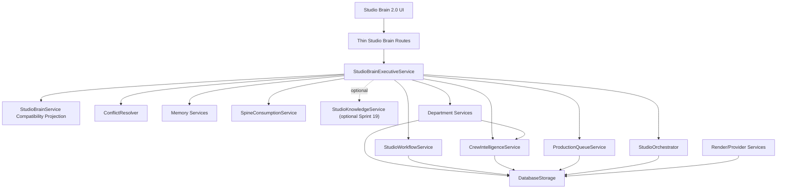

# Sprint 20: Studio Brain 2.0 Master Orchestration Layer

Create the master orchestration layer that coordinates every department, resolves conflicts, plans productions, and functions as the studio's executive intelligence.

## Repository Evidence Used

This specification was authored after inspecting the current worktree. The following existing systems are treated as authoritative integration anchors:

- `studio-backend/app/services/studio_brain_service.py`: current deterministic, advisory-only Studio Brain bundle builder.
- `studio-backend/app/services/orchestrator.py`: existing task execution orchestrator with workflow chains, retry handling, task handoffs, and crew reasoning bridge.
- `studio-backend/app/models/crew.py`: existing crew roles, task lifecycle, system-orchestrator boundary, creator authority model, escalation reasons, and conflict enums.
- `studio-backend/app/models/crew_intelligence.py`: existing reasoning ledger, evidence refs, memory refs, spine refs, handoff packets, deliberations, department profiles, department statuses, and creator attention items.
- `studio-backend/app/services/crew_intelligence_service.py`: canonical service for durable department reasoning, handoffs, deliberations, role context, language guardrails, and crew overview.
- `studio-backend/app/services/conflicts.py`: existing conflict detection and resolution service with priority rules and escalation pathways.
- `studio-backend/app/services/director_memory_resolver.py`: existing Director and Memory Archivist merge policy where Director authority is preserved and continuity analysis is attached.
- `studio-backend/app/models/memory.py`: canonical project, scene, character, style, review, film, act, sequence, motif, tension, and emotional trajectory memory models.
- `studio-backend/app/models/spine.py`: Creative Spine governance model, explicitly not a memory system.
- `studio-backend/app/services/spine_service.py` and `studio-backend/app/services/spine_consumption_service.py`: Creative Spine creation, drift, and role-filtered consumption.
- `studio-backend/app/services/studio_workflow_service.py`: canonical professional workflow layer for phases, artifact versions, approval gates, decisions, comments, tasks, events, and explicit creative memory saves.
- `studio-backend/app/models/studio_workflow.py`: workflow phase, status, artifact, gate, decision, evidence, collaborator, and version contracts.
- `studio-backend/app/data/storage.py`: SQLite migrations and storage helpers for memory, cinematic memory, crew reasoning, handoffs, workflow, queue, and department records.
- `studio-backend/app/services/script_parser.py`: current script breakdown bundle includes `studio_brain_orchestration`, `studio_brain_timeline`, and `studio_brain_reasoning_trace`.
- Department intelligence services and models for performance, cinematography, performance audio, production design, colorist, editorial, continuity, queue, acceptance, and render validation.
- `studio-app/src/components/StudioBrainOrchestrationPanel.tsx`: current frontend Studio Brain surface.
- `studio-app/src/components/StudioBrainOrchestrationPanel.test.tsx`: current UI contract for timeline and reasoning trace.
- `plans/sprint_19_studio_knowledge_canonical_intelligence_engine_spec.md`: planned canonical knowledge layer. The current tree does not contain `app/models/studio_knowledge.py` or `app/services/studio_knowledge_service.py`, so Sprint 20 must integrate with Sprint 19 when implemented but cannot assume it exists today.

## 1. Executive Summary

### Why This Section Exists

This section establishes the sprint mandate in implementable terms before engineering enters model, storage, service, API, and UI detail. Sprint 20 must transform Studio Brain from a deterministic summary bundle into the executive intelligence layer of AI Film Studio. The new layer must coordinate every AI department, assemble production plans, detect and resolve operational conflicts, escalate creative decisions to the creator, and maintain inspectable reasoning for every major production recommendation.

The sprint must not replace the existing task orchestrator, Crew Intelligence ledger, Studio Workflow gates, MemoryService, Creative Spine, provider abstractions, or department services. The current architecture already has pieces of orchestration:

- `StudioOrchestrator` executes low-level crew tasks.
- `CrewIntelligenceService` records durable department reasoning, handoffs, deliberations, and creator attention.
- `StudioWorkflowService` owns artifact versions, approval gates, comments, events, and explicit memory save gates.
- `StudioBrainService` builds a deterministic advisory bundle for script breakdown outputs.
- `ConflictResolver` detects and escalates basic conflicts.
- Department services expose plans, assessments, memory refs, spine refs, evidence refs, and department signals.

Sprint 20 introduces the missing executive layer above those pieces:

- It chooses which departments should participate in a production decision.
- It asks departments for signals through their service boundaries.
- It builds production-wide plans from canonical evidence.
- It resolves non-creative operational conflicts using explicit rules.
- It escalates creative, authority, policy, and ambiguity conflicts through Studio Workflow and Crew Intelligence.
- It records all executive decisions as inspectable, advisory-only reasoning artifacts.
- It exposes a Studio Brain 2.0 dashboard that shows plan, department readiness, conflicts, unresolved decisions, dependencies, and traceable reasoning.

### Architectural Decisions

The central decision is to evolve the current `StudioBrainService` without turning it into a monolith. The implementation should introduce a new service boundary named `StudioBrainExecutiveService` in `studio-backend/app/services/studio_brain_executive_service.py`, while preserving `StudioBrainService.build_orchestration_bundle()` for backward compatibility.

`StudioBrainExecutiveService` owns executive coordination. It does not own task execution, memory truth, creative authority, provider execution, render lifecycle, queue persistence, or department-specific analysis. Its output is a set of durable executive artifacts:

- `StudioBrainExecutiveSession`
- `StudioBrainProductionPlan`
- `StudioBrainDepartmentSignal`
- `StudioBrainConflictCase`
- `StudioBrainResolutionDecision`
- `StudioBrainCreatorEscalation`
- `StudioBrainExecutionDirective`
- `StudioBrainReasoningTrace`
- `StudioBrainReadinessSnapshot`

The existing `StudioBrainService` should become a compatibility facade:

- Keep `build_orchestration_bundle()` as-is for existing script parser tests and UI surfaces.
- Add an optional method `build_orchestration_bundle_v2()` or adapter that projects `StudioBrainExecutiveSession` into the existing timeline/trace shape.
- Do not break `script_parser.py`, current tests, or current frontend surfaces.

### Implementation Strategy

Implement Sprint 20 in additive phases:

1. Add typed Pydantic models in `app/models/studio_brain.py`.
2. Add SQLite migrations and storage helpers in `app/data/storage.py`.
3. Implement `StudioBrainExecutiveService` with dependency-injected access to storage, `CrewIntelligenceService`, `StudioWorkflowService`, `StudioOrchestrator`, `ConflictResolver`, `MemoryService`, `SpineConsumptionService`, and available department services.
4. Add department-signal adapter methods. Each adapter must call the existing service, not duplicate its logic.
5. Add production-plan generation that produces an inspectable plan from existing project, workflow, queue, memory, spine, and department evidence.
6. Add conflict aggregation and resolution rules. Non-creative operational conflicts may be resolved by deterministic policy; creative conflicts must be escalated.
7. Add execution directives that route actionable work to existing systems: crew tasks, workflow gates, queue items, or department services. Directives are instructions to existing systems, not a separate executor.
8. Add thin FastAPI routes under `/api/f51/studio/projects/{project_id}/brain`.
9. Extend frontend API contracts and add `StudioBrainExecutivePanel`, `StudioBrainPlanDrawer`, `StudioBrainConflictPanel`, and `StudioBrainTraceDrawer`.
10. Expand tests at model, service, storage, route, frontend, regression, and production verification levels.

### Integration Points

Primary backend integration points:

- `app.services.studio_brain_service.StudioBrainService`
- new `app.services.studio_brain_executive_service.StudioBrainExecutiveService`
- `app.services.orchestrator.StudioOrchestrator`
- `app.services.crew_intelligence_service.CrewIntelligenceService`
- `app.services.studio_workflow_service.StudioWorkflowService`
- `app.services.conflicts.ConflictResolver`
- `app.services.memory.MemoryService`
- `app.services.spine_consumption_service.SpineConsumptionService`
- `app.services.production_queue_service.ProductionQueueService`
- `app.services.production_acceptance_service.ProductionAcceptanceService`
- department services for performance, cinematography, performance audio, production design, colorist, editorial, continuity, render validation, and director commentary
- `app.data.storage.DatabaseStorage`
- `main.py` router registration and lifespan wiring

Primary frontend integration points:

- `studio-app/src/lib/studioApi.ts`
- new `studio-app/src/lib/studioBrainApi.ts`
- `studio-app/src/components/StudioBrainOrchestrationPanel.tsx`
- new Studio Brain executive components
- `ProductionBoard.tsx`, `ProjectWorkspace.tsx`, `PrevisRoom.tsx`, `ScreeningRoom.tsx`, `StudioDevTools.tsx`

### Potential Failure Modes

Sprint 20 fails architecturally if it:

- Replaces `StudioOrchestrator` with another task runner.
- Creates another memory store or knowledge store.
- Lets Studio Brain mutate Creative Spine, FilmLevelMemory, render jobs, or workflow gates without using the canonical service.
- Lets an AI department make creative decisions without creator approval.
- Hides conflicts by choosing a winner without recording evidence.
- Emits scores, ratings, percentages, generic praise, or humiliating language in creator-facing advisory text.
- Makes every issue blocking and slows production flow.
- Produces plans that cannot be traced back to memory, spine, workflow, queue, department, or knowledge evidence.
- Couples provider-specific logic into the executive layer.
- Assumes Sprint 19 is already implemented in code.

### Validation Strategy

Validation must prove the executive layer is additive, deterministic where required, explainable, and safely integrated:

- Existing `StudioBrainService` tests must still pass.
- Existing script ingest outputs must still include the current `studio_brain_orchestration` shape.
- New executive sessions must persist and reload with stable schemas.
- Every executive decision must include evidence refs, source service names, and a reasoning trace.
- Every conflict must resolve through deterministic non-creative policy or escalate to creator attention.
- Creative conflicts must never auto-resolve into canonical state changes.
- Generated plans must create directives to existing services, not execute hidden side effects.
- Frontend surfaces must show status, plan, conflict, and trace without making the Studio Brain look like a creative authority.

## 2. Vision

### Why This Section Exists

The vision defines the long-term product identity of Studio Brain 2.0. AI Film Studio is meant to support feature-length filmmaking with many departments, revisions, assets, approval gates, memory records, render jobs, and creative constraints. A simple timeline summary cannot coordinate that complexity.

Studio Brain 2.0 should feel like the executive intelligence of a serious production studio: aware of the story spine, aware of memory, aware of every department's current reasoning, aware of production dependencies, aware of risk, and clear about what it can and cannot decide.

### Architectural Decisions

The vision is not "one AI to rule the studio." The executive layer is a conductor and inspector:

- It coordinates.
- It prioritizes.
- It resolves operational contention.
- It clarifies creative tradeoffs.
- It plans the next production move.
- It preserves the creator's authority.
- It exposes why the studio thinks a decision matters.

The system must use a layered authority model:

1. Creator decisions and approved workflow gates are highest authority.
2. Creative Spine governs protected film identity.
3. Film, act, sequence, scene, character, style, and explicit decision memory provide canonical context.
4. Studio Knowledge Engine, when implemented, normalizes context into citeable atoms.
5. Department services produce advisory plans and signals within their domain.
6. Studio Brain executive layer synthesizes and coordinates those signals.
7. `StudioOrchestrator` executes tasks only after directives are approved or policy-allowed.
8. Provider services execute render and media work behind provider abstractions.

### Implementation Strategy

Studio Brain 2.0 must provide the following long-term capabilities:

- Project-wide situational awareness.
- Phase-aware production planning.
- Department selection by production purpose.
- Cross-department conflict detection.
- Readiness assessment for production, screening, revision, packaging, and delivery.
- Creator attention queue with clear rationale.
- Inspectable executive reasoning trace.
- Backward-compatible Studio Brain timeline projection.
- Extensible department registry.
- Ability to consume Sprint 19 `StudioKnowledgeService` context packs when present.

### Integration Points

The vision spans all rooms:

- Study: executive awareness of reference studies and knowledge readiness.
- Writers Room: story structure, scene intent, character pressure, and script changes.
- Previs: shot planning, camera grammar, production design, performance, audio, and render readiness.
- Production Board: queue state, provider readiness, render failures, retry directives, and acceptance gates.
- Screening Room: cut review, editorial continuity, color, sound, performance, and memory callback analysis.
- Archive: package readiness, provenance, approvals, and delivery evidence.

### Potential Failure Modes

The vision fails if Studio Brain becomes either too passive or too powerful. Too passive means it only summarizes. Too powerful means it mutates truth or overrides creators. The correct target is executive judgment with inspectable boundaries.

### Validation Strategy

Validate with feature-length scenarios:

- A project with many scenes, unresolved tensions, department plans, render jobs, and revision loops.
- Contradictory department signals.
- Missing memory and missing Sprint 19 service.
- Existing projects with no executive sessions.
- Creator decisions that override Studio Brain recommendations.
- Recovery from provider and queue failures.

## 3. Mission

### Why This Section Exists

The mission converts the vision into sprint obligations and prevents drift into speculative autonomy, provider rewrites, or broad infrastructure expansion.

### Architectural Decisions

Sprint 20's mission is to create a production-grade executive coordination layer that sits above existing departments and workflows. It must coordinate without owning the underlying systems. It must be able to plan, explain, escalate, and verify, but it must not silently perform creative actions.

### Implementation Strategy

The sprint must deliver:

1. Pydantic models for executive sessions, plans, department signals, conflicts, resolutions, directives, readiness, and traces.
2. Durable storage for executive artifacts.
3. A service layer that gathers context from canonical services.
4. Department signal adapters.
5. Phase-aware production plan generation.
6. Deterministic operational conflict resolution.
7. Creator escalation for creative and authority conflicts.
8. Execution directives routed to existing services.
9. API routes for session creation, inspection, plan generation, conflict review, readiness, and directive dispatch.
10. Frontend Studio Brain 2.0 surfaces.
11. Tests and verification artifacts.
12. Compatibility with current `studio_brain_orchestration` bundles.

### Integration Points

The mission depends on existing service boundaries:

- `StudioBrainService` for compatibility projection.
- `CrewIntelligenceService` for durable reasoning and attention.
- `StudioWorkflowService` for gates and events.
- `StudioOrchestrator` for crew task execution.
- `ConflictResolver` for existing conflict rules.
- Memory and Spine services for canonical truth.
- Department services for domain signals.

### Potential Failure Modes

Mission failure occurs if the executive layer directly queries raw tables, directly writes canonical memory, directly calls provider adapters, or creates a separate queue. It also fails if department services keep adding one-off Studio Brain payloads without a shared contract.

### Validation Strategy

Mission validation requires an end-to-end executive session:

- Build a session for a project.
- Gather department signals.
- Generate a plan.
- Detect at least one conflict.
- Resolve an operational conflict.
- Escalate a creative conflict.
- Persist and inspect the reasoning trace.
- Project the session into the old timeline/trace shape.
- Confirm no canonical memory, spine, render job, or provider state was mutated without the canonical service.

## 4. Goals

### Why This Section Exists

Goals define concrete deliverables that can be assigned, tested, and accepted.

### Architectural Decisions

All goals reinforce the architecture's current direction: service-mediated logic, Pydantic API contracts, SQLite persistence through `DatabaseStorage`, advisory co-director voice, explicit memory saves, provider abstraction, and thin routes.

### Implementation Strategy

Sprint 20 goals:

1. Add `app/models/studio_brain.py` with DTOs for:
   - `StudioBrainSessionStatus`
   - `StudioBrainSessionPurpose`
   - `StudioBrainAuthorityBoundary`
   - `StudioBrainSourceRef`
   - `StudioBrainDepartmentSignal`
   - `StudioBrainProductionPlan`
   - `StudioBrainPlanStep`
   - `StudioBrainDependency`
   - `StudioBrainConflictCase`
   - `StudioBrainResolutionDecision`
   - `StudioBrainCreatorEscalation`
   - `StudioBrainExecutionDirective`
   - `StudioBrainReadinessSnapshot`
   - `StudioBrainReasoningTrace`
   - `StudioBrainExecutiveSession`
   - API request and response DTOs.
2. Add storage migrations for:
   - `studio_brain_sessions`
   - `studio_brain_department_signals`
   - `studio_brain_production_plans`
   - `studio_brain_conflicts`
   - `studio_brain_resolution_decisions`
   - `studio_brain_execution_directives`
   - `studio_brain_readiness_snapshots`
   - `studio_brain_reasoning_traces`
3. Implement storage helpers in `DatabaseStorage`, with JSON fields serialized through existing helper patterns.
4. Implement `StudioBrainExecutiveService`.
5. Preserve `StudioBrainService.build_orchestration_bundle()`.
6. Add a compatibility adapter from executive sessions to current timeline/trace payloads.
7. Add department signal adapters for existing departments.
8. Add production plan generation.
9. Add conflict aggregation, resolution, and escalation.
10. Add directive dispatch to existing systems.
11. Add thin routes under `/api/f51/studio/projects/{project_id}/brain`.
12. Register routes in `main.py`.
13. Add frontend API client and types.
14. Upgrade Studio Brain UI while keeping old panel compatibility.
15. Add backend and frontend tests.
16. Add docs and verification checklist.

### Integration Points

Goals integrate with the current codebase rather than replacing it. For example, production planning should call `StudioWorkflowService.workflow_summary()` and queue services, not scan workflow tables directly. Department signals should call each department service's existing `department_signal()` or equivalent method where present.

### Potential Failure Modes

Goals fail if model scope grows without service implementation, if storage lacks indexes for feature-length scale, or if UI ships without enough backend traceability to inspect decisions.

### Validation Strategy

Each goal requires direct evidence:

- Pydantic model tests.
- Storage round-trip tests.
- Service unit tests with fake department services.
- Route tests.
- Frontend render tests.
- Regression tests proving the old Studio Brain bundle still works.

## 5. Non-Goals

### Why This Section Exists

Non-goals keep the sprint from becoming an infrastructure rewrite or speculative autonomy sprint.

### Architectural Decisions

Sprint 20 must not:

1. Replace `StudioOrchestrator`.
2. Replace `CrewIntelligenceService`.
3. Replace `StudioWorkflowService`.
4. Replace `MemoryService`, `DirectorMemoryService`, `CinematicMemoryService`, `StudyMemoryService`, or future `StudioKnowledgeService`.
5. Replace `CreativeSpine`.
6. Replace department intelligence services.
7. Replace render provider abstractions.
8. Introduce a new external workflow engine.
9. Introduce a new vector database, message broker, or distributed scheduler.
10. Give AI departments creative authority.
11. Auto-save creative memories.
12. Auto-approve Creative Spine deviations.
13. Make co-director notes appear on every poll or refresh.
14. Add numeric creator-facing quality scores, ratings, or percentages.
15. Implement every future department. The sprint should define registry extensibility and integrate existing departments.

### Implementation Strategy

The service must produce recommendations and directives, then route actionable work through canonical services. It may create workflow gates and crew tasks through services. It may not directly mutate provider jobs, memory, spine, or project JSON state outside canonical owners.

### Integration Points

Non-goals protect integration boundaries:

- Existing orchestrator remains low-level executor.
- Studio Brain executive layer remains decision coordinator.
- Workflow remains source of truth for approvals.
- Crew Intelligence remains source of truth for department reasoning.
- Memory and Spine remain source of truth for project identity.

### Potential Failure Modes

The most tempting failure is to implement "just enough" by stuffing more fields into `script_parser.py` or `StudioBrainService`. That would deepen an existing large bundle and make the executive layer hard to test. Sprint 20 must create a modular service instead.

### Validation Strategy

Code review must search for:

- Direct provider adapter calls from Studio Brain.
- Raw SQL outside storage.
- Direct mutation of memory or spine from the executive service.
- Duplicate queue tables.
- Duplicate reasoning ledger tables.
- Creator-facing prohibited language.

## 6. Existing Architecture Analysis

### Why This Section Exists

This section documents what exists so implementation avoids duplication and preserves backward compatibility.

### Architectural Decisions

The current architecture already has the right layer separation:

- Routes parse and format HTTP.
- Services own business logic.
- Storage owns SQLite access.
- Department services own domain-specific intelligence.
- Crew Intelligence records durable reasoning and handoffs.
- Studio Workflow records gates, approvals, versions, comments, events, and explicit memory saves.
- Creative Spine governs identity and constraints.
- Memory services own memory records.
- Render services own provider abstraction and job lifecycle.

Studio Brain 2.0 should sit above service-level outputs as a coordinator and inspector.

### Implementation Strategy

Current system analysis:

1. `studio_brain_service.py` is advisory-only and deterministic. It takes pre-assembled contexts and returns a timeline, trace, boundary map, and deterministic signature. It should be preserved.
2. `orchestrator.py` is a task runner with workflow chains. It owns run loops, pending task detection, executor dispatch, retry handling, next task creation, and crew reasoning/handoff bridge. It should not become the executive brain.
3. `crew_intelligence_service.py` already provides a durable reasoning ledger with language guardrails. It should be the canonical store for department reasoning and creator attention.
4. `studio_workflow_service.py` already provides professional workflow state. It should own approval gates and events.
5. `conflicts.py` provides initial conflict primitives but uses basic field comparisons and priority logic. Sprint 20 should extend conflict handling into Studio Brain-specific conflict cases without deleting the existing service.
6. `director_memory_resolver.py` establishes the correct authority model: Director decision remains authoritative, Memory Archivist context attaches, critical alerts may require acknowledgment, and continuity debt is tracked.
7. Department services increasingly expose `memory_refs`, `spine_refs`, `crew_reasoning_id`, and `department_signal()`. Sprint 20 should standardize how Studio Brain consumes those signals.
8. Frontend has a current `StudioBrainOrchestrationPanel` that reads `executionSummary.studio_brain_orchestration`. The new UI must not break this.
9. Sprint 19's Studio Knowledge Engine is specified but not implemented in the current tree. Sprint 20 must design an optional dependency with graceful fallback to current memory/spine/crew systems.

### Integration Points

Existing code integration points:

- Backend models: `crew.py`, `crew_intelligence.py`, `memory.py`, `spine.py`, `studio_workflow.py`.
- Backend services: `studio_brain_service.py`, `orchestrator.py`, `crew_intelligence_service.py`, `studio_workflow_service.py`, `conflicts.py`, department services.
- Backend routes: `crew.py`, `studio_workflow.py`, department routes.
- Frontend components: `StudioBrainOrchestrationPanel`, `CrewIntelligencePanel`, `ProductionExecutionBay`, `ProductionQueueSummaryStrip`, `DecisionGateCard`, `ScreeningIntelligencePanel`.

### Potential Failure Modes

Existing architecture risks:

- `script_parser.py` currently assembles an extremely large execution summary. Adding executive logic there would increase coupling.
- Current `StudioBrainService` includes `score` as an input key in emotional arc context, which is not appropriate as creator-facing language. Sprint 20 should avoid exposing numeric scores in new UI copy and should treat legacy numeric fields as internal evidence only.
- Some route files contain service singleton wiring. Sprint 20 should avoid adding new route-level business logic.
- Sprint 19 is not implemented yet, so hard importing `StudioKnowledgeService` would break runtime.

### Validation Strategy

Validation requires repository checks:

- Confirm `StudioBrainService` tests pass unchanged.
- Confirm new executive service does not import provider adapters.
- Confirm routes only call `studio_brain_executive_service`.
- Confirm storage methods encapsulate all SQL.
- Confirm frontend can render with and without executive session data.

## 7. Repository Inspection Checklist

### Why This Section Exists

This checklist gives implementers a concrete inspection workflow before writing code.

### Architectural Decisions

Before implementation, engineers must verify current files because this codebase is evolving quickly. The specification intentionally names files, but current state remains authoritative.

### Implementation Strategy

Run the following inspection before coding:

1. Search for current Studio Brain usage:
   - `rg -n "StudioBrainService|studio_brain_orchestration|studio_brain_timeline|studio_brain_reasoning_trace" studio-backend studio-app/src`
2. Inspect current service:
   - `studio-backend/app/services/studio_brain_service.py`
   - `studio-backend/app/services/test_studio_brain_service.py`
3. Inspect orchestrator and task execution:
   - `studio-backend/app/services/orchestrator.py`
   - `studio-backend/app/services/orchestrator_executors.py`
   - `studio-backend/app/services/crew.py`
   - `studio-backend/app/models/crew.py`
4. Inspect Crew Intelligence:
   - `studio-backend/app/models/crew_intelligence.py`
   - `studio-backend/app/services/crew_intelligence_service.py`
   - `studio-backend/app/routes/crew.py`
5. Inspect workflow:
   - `studio-backend/app/models/studio_workflow.py`
   - `studio-backend/app/services/studio_workflow_service.py`
   - `studio-backend/app/routes/studio_workflow.py`
6. Inspect memory and spine:
   - `studio-backend/app/models/memory.py`
   - `studio-backend/app/services/memory.py`
   - `studio-backend/app/services/director_memory_service.py`
   - `studio-backend/app/models/spine.py`
   - `studio-backend/app/services/spine_service.py`
   - `studio-backend/app/services/spine_consumption_service.py`
7. Inspect conflict systems:
   - `studio-backend/app/services/conflicts.py`
   - `studio-backend/app/services/director_memory_resolver.py`
8. Inspect department signal patterns:
   - `rg -n "department_signal|memory_refs|spine_refs|crew_reasoning_id" studio-backend/app/services studio-backend/app/models`
9. Inspect storage migration style:
   - `studio-backend/app/data/storage.py`
10. Inspect frontend surfaces:
   - `studio-app/src/components/StudioBrainOrchestrationPanel.tsx`
   - `studio-app/src/components/CrewIntelligencePanel.tsx`
   - `studio-app/src/components/ProductionExecutionBay.tsx`
   - `studio-app/src/lib/studioApi.ts`
11. Check whether Sprint 19 is implemented:
   - `rg --files studio-backend/app | rg "studio_knowledge|knowledge_service"`

### Integration Points

The checklist ties implementation to real code paths. It must be repeated before coding because future sprints may implement Sprint 19 or add department signal methods.

### Potential Failure Modes

Failure modes:

- Implementing against stale assumptions from the specification.
- Missing a newly added department service.
- Duplicating storage helpers that already exist.
- Breaking current script parser compatibility.

### Validation Strategy

The first PR should include an "inspection completed" note in implementation docs listing actual files touched and confirming whether `StudioKnowledgeService` exists.

## 8. Gap Analysis

### Why This Section Exists

Gap analysis identifies what Sprint 20 must add and what it must avoid duplicating.

### Architectural Decisions

The major gap is not "no orchestration." The gap is "no executive orchestration." The codebase has execution orchestration, crew reasoning, workflow gates, and department services. It lacks a master coordination layer that can reason over all of them.

### Implementation Strategy

Current gaps:

1. No durable Studio Brain executive session.
   - Current `StudioBrainService` returns ephemeral bundle dictionaries.
2. No standardized department signal contract for Studio Brain.
   - Some departments have signal methods; some expose records or assessments only.
3. No project-wide production plan model.
   - Workflow and queue know state, but there is no executive plan across phases and departments.
4. No cross-department conflict case model tied to evidence, memory, spine, and workflow.
   - `conflicts.py` is generic and basic.
5. No executive resolution decision ledger.
   - Crew reasoning stores department records, but Studio Brain resolutions need their own trace while also writing to Crew Intelligence.
6. No creator escalation model specific to executive conflicts.
   - Crew attention exists, but Studio Brain needs structured escalation payloads that can create workflow gates.
7. No execution directive model.
   - The executive layer needs a safe way to propose or dispatch actions through canonical services.
8. No readiness snapshot for phase transitions.
   - Production readiness is spread across queue, provider readiness, acceptance, workflow, and department panels.
9. No frontend executive dashboard.
   - Current panel shows timeline and trace only.
10. No optional Sprint 19 context-pack integration.
   - The specification exists, but code is not present.
11. No feature-length production planning heuristics.
   - Existing logic often works at project or scene scale, but not as a unified executive plan.

### Integration Points

Each gap maps to existing owners:

- Session and plan storage: new Studio Brain tables.
- Department reasoning: Crew Intelligence.
- Production state: Studio Workflow and Production Queue.
- Canonical context: Memory, Spine, and future Studio Knowledge.
- Execution: StudioOrchestrator and department services.
- Frontend display: current Studio Brain and Crew panels.

### Potential Failure Modes

Gap closure can fail by adding too much autonomy too soon. The first implementation should emphasize inspection, planning, conflict surfacing, and safe directives. Fully autonomous continuous executive loops should remain future extensibility unless explicitly enabled.

### Validation Strategy

Validate gaps with tests:

- A project with no department records still gets a partial session.
- A project with department records gets normalized signals.
- Contradictory signals create conflict cases.
- Operational conflicts resolve with trace.
- Creative conflicts create creator escalation and workflow gate.
- Readiness snapshot explains missing evidence.

## 9. Architectural Principles

### Why This Section Exists

Principles constrain implementation decisions and keep the sprint aligned with the project's long-term architecture.

### Architectural Decisions

Sprint 20 principles:

1. Additive over replacement.
2. Service-mediated access only.
3. Creator authority is final.
4. Studio Brain is executive, not canonical truth.
5. Every decision is inspectable.
6. Every recommendation cites evidence.
7. Provider implementations remain abstract.
8. Departments own domain reasoning.
9. Crew Intelligence owns the durable cross-department reasoning ledger.
10. Studio Workflow owns approval and phase gates.
11. Memory and Spine remain canonical owners.
12. Knowledge Engine, when implemented, is consumed as a context resolver, not replaced.
13. Creative output is advisory and filmmaker-respectful.
14. Feature-length scale is a first-class design constraint.
15. Determinism is required for policy decisions and signatures; LLM-assisted synthesis must be optional, bounded, and traceable.

### Implementation Strategy

Apply principles through code rules:

- `routes/studio_brain.py` must be thin.
- `StudioBrainExecutiveService` must accept dependencies.
- Storage writes must go through `DatabaseStorage`.
- Department access must go through service adapters.
- Directives must be explicit records before dispatch.
- Any LLM synthesis must store prompt purpose, source refs, model/provider abstraction, and fallback.
- Creator-facing language must pass guardrails similar to `CrewIntelligenceService._language_warnings()`.

### Integration Points

Principles integrate with:

- `app.services.stability` error classes and logging helpers.
- Crew Intelligence language guardrails.
- Workflow approval gates.
- Memory explicit-save policy.
- Provider abstraction patterns.

### Potential Failure Modes

Principles are violated if implementation prioritizes a quick dashboard over durable reasoning. Studio Brain 2.0 must be a product feature and an architecture feature.

### Validation Strategy

Validation includes code review checklists, automated tests, and static search:

- No raw SQL outside storage.
- No provider adapter imports in Studio Brain executive service.
- No direct `project_store.save_creative_memory()` call from Studio Brain.
- No direct spine mutation from Studio Brain.
- No creator-facing prohibited language.

## 10. High-Level System Design

### Why This Section Exists

High-level design shows how components collaborate before drilling into individual models and methods.

### Architectural Decisions

Studio Brain 2.0 uses a layered coordinator architecture:



### Implementation Strategy

The service has five main workflows:

1. `open_session()`
   - Creates or resumes an executive session for a project and purpose.
2. `gather_department_signals()`
   - Collects role-filtered signals from available departments.
3. `generate_production_plan()`
   - Builds a phase-aware plan with dependencies, readiness, risks, and directives.
4. `detect_and_resolve_conflicts()`
   - Converts overlapping department signals into conflict cases and resolution decisions.
5. `dispatch_directive()`
   - Sends approved or policy-allowed directives to canonical systems.

### Integration Points

The high-level flow relies on:

- Department services for raw signals.
- Crew Intelligence for reasoning persistence.
- Workflow for approvals and events.
- Orchestrator for task execution.
- Queue and render services for production state.
- Storage for durable Studio Brain artifacts.

### Potential Failure Modes

High-level failure modes:

- Cyclic calls between Studio Brain and departments.
- Hidden side effects during signal gathering.
- Long-running synchronous calls causing UI timeouts.
- Inconsistent status if directives dispatch but storage persistence fails.

### Validation Strategy

Validation requires:

- Fake dependency tests for each workflow.
- Timeout and partial data behavior.
- Idempotent session generation.
- Directive dispatch atomicity expectations documented and tested.

## 11. Component Design

### Why This Section Exists

Component design turns high-level architecture into implementable classes, responsibilities, and method contracts.

### Architectural Decisions

Add one new model module, one new service module, one new route module, and one frontend API module. Extend existing `StudioBrainService` only for compatibility projection.

### Implementation Strategy

#### Backend Models: `app/models/studio_brain.py`

Define enums:

- `StudioBrainSessionPurpose`: `project_overview`, `phase_planning`, `previs_planning`, `production_planning`, `screening_review`, `revision_planning`, `packaging_readiness`, `conflict_review`, `manual_inspection`.
- `StudioBrainSessionStatus`: `open`, `planning`, `waiting_creator`, `ready_to_dispatch`, `dispatching`, `complete`, `failed`, `cancelled`.
- `StudioBrainPlanStatus`: `draft`, `ready`, `partially_blocked`, `waiting_creator`, `dispatched`, `superseded`.
- `StudioBrainConflictType`: `creative_authority`, `continuity`, `spine_drift`, `memory_contradiction`, `department_disagreement`, `resource_contention`, `provider_readiness`, `workflow_dependency`, `queue_block`, `acceptance_gap`, `missing_evidence`.
- `StudioBrainConflictSeverity`: `advisory`, `needs_attention`, `requires_decision`, `blocks_dispatch`.
- `StudioBrainDirectiveType`: `create_crew_task`, `create_workflow_gate`, `request_department_analysis`, `enqueue_render`, `request_revision`, `record_attention`, `pause_workflow`, `resume_workflow`, `no_action`.
- `StudioBrainDirectiveStatus`: `proposed`, `approved`, `dispatched`, `completed`, `failed`, `cancelled`.
- `StudioBrainResolutionMode`: `auto_operational`, `attach_advisory_context`, `escalate_creator`, `defer_missing_evidence`, `supersede_stale_signal`.

Define models:

- `StudioBrainSourceRef`
- `StudioBrainAuthorityBoundary`
- `StudioBrainDepartmentSignal`
- `StudioBrainDependency`
- `StudioBrainRisk`
- `StudioBrainPlanStep`
- `StudioBrainProductionPlan`
- `StudioBrainConflictCase`
- `StudioBrainResolutionDecision`
- `StudioBrainCreatorEscalation`
- `StudioBrainExecutionDirective`
- `StudioBrainReadinessSnapshot`
- `StudioBrainReasoningTrace`
- `StudioBrainExecutiveSession`

#### Backend Service: `app/services/studio_brain_executive_service.py`

Core methods:

```python
class StudioBrainExecutiveService:
    def open_session(self, project_id: str, purpose: StudioBrainSessionPurpose, scope: dict[str, Any] | None = None) -> StudioBrainExecutiveSession: ...
    def gather_department_signals(self, session_id: str, refresh: bool = False) -> list[StudioBrainDepartmentSignal]: ...
    def generate_production_plan(self, session_id: str) -> StudioBrainProductionPlan: ...
    def detect_conflicts(self, session_id: str) -> list[StudioBrainConflictCase]: ...
    def resolve_conflict(self, session_id: str, conflict_id: str, actor_id: str = "studio_brain") -> StudioBrainResolutionDecision: ...
    def create_readiness_snapshot(self, session_id: str) -> StudioBrainReadinessSnapshot: ...
    def propose_directives(self, session_id: str) -> list[StudioBrainExecutionDirective]: ...
    def dispatch_directive(self, session_id: str, directive_id: str, actor_id: str) -> StudioBrainExecutionDirective: ...
    def get_session(self, session_id: str) -> StudioBrainExecutiveSession | None: ...
    def list_sessions(self, project_id: str, limit: int = 20) -> list[StudioBrainExecutiveSession]: ...
    def project_legacy_bundle(self, session_id: str) -> dict[str, Any]: ...
```

#### Compatibility Service Extension

Add to `StudioBrainService`:

```python
def build_orchestration_bundle_from_executive_session(self, session: StudioBrainExecutiveSession | dict[str, Any]) -> dict[str, Any]:
    ...
```

This returns the existing keys:

- `orchestration_timeline`
- `creative_reasoning_trace`
- `canonical_truth_boundaries`
- `deterministic_audit`

#### Routes: `app/routes/studio_brain.py`

Routes:

- `POST /api/f51/studio/projects/{project_id}/brain/sessions`
- `GET /api/f51/studio/projects/{project_id}/brain/sessions`
- `GET /api/f51/studio/projects/{project_id}/brain/sessions/{session_id}`
- `POST /api/f51/studio/projects/{project_id}/brain/sessions/{session_id}/signals/refresh`
- `POST /api/f51/studio/projects/{project_id}/brain/sessions/{session_id}/plan`
- `POST /api/f51/studio/projects/{project_id}/brain/sessions/{session_id}/conflicts/detect`
- `POST /api/f51/studio/projects/{project_id}/brain/sessions/{session_id}/conflicts/{conflict_id}/resolve`
- `POST /api/f51/studio/projects/{project_id}/brain/sessions/{session_id}/readiness`
- `POST /api/f51/studio/projects/{project_id}/brain/sessions/{session_id}/directives`
- `POST /api/f51/studio/projects/{project_id}/brain/sessions/{session_id}/directives/{directive_id}/dispatch`
- `GET /api/f51/studio/projects/{project_id}/brain/latest`

#### Frontend Components

New components:

- `StudioBrainExecutivePanel.tsx`
- `StudioBrainPlanDrawer.tsx`
- `StudioBrainConflictPanel.tsx`
- `StudioBrainDepartmentMatrix.tsx`
- `StudioBrainTraceDrawer.tsx`
- `StudioBrainDirectiveList.tsx`
- `StudioBrainReadinessStrip.tsx`

### Integration Points

Component integration must remain directional:

- UI calls route.
- Route calls executive service.
- Executive service calls canonical services.
- Canonical services call storage.
- Executive service writes Studio Brain artifacts through storage.

### Potential Failure Modes

Component failure modes:

- A department adapter throws and prevents the session from loading.
- A missing Sprint 19 service import breaks session generation.
- A directive is dispatched twice.
- A conflict is resolved without a trace.
- Frontend assumes fields are present and crashes on partial data.

### Validation Strategy

Each component needs tests:

- Model validation tests.
- Service fake dependency tests.
- Storage round-trip tests.
- Route tests.
- React render tests with partial data.
- Regression tests for old panel.

## 12. Data Model Changes

### Why This Section Exists

Data model changes define durable contracts and storage shape before implementation.

### Architectural Decisions

Studio Brain artifacts are durable derived records. They do not become canonical story truth. They cite canonical sources and can be superseded. This design supports audit, replay, and feature-length production history.

### Implementation Strategy

#### `StudioBrainSourceRef`

Fields:

- `source_ref_id: str`
- `source_type: str`
- `source_service: str`
- `source_id: str`
- `project_id: str`
- `scene_id: str | None`
- `shot_id: str | None`
- `asset_id: str | None`
- `field_path: str`
- `summary: str`
- `authority_level: str`
- `staleness: str`
- `metadata: dict[str, Any]`

#### `StudioBrainDepartmentSignal`

Fields:

- `signal_id`
- `session_id`
- `project_id`
- `agent_role`
- `department_name`
- `status`: `standby`, `ready`, `active`, `blocked`, `needs_creator`, `unavailable`, `failed`
- `purpose`
- `summary`
- `recommended_actions`
- `risks`
- `open_questions`
- `source_refs`
- `memory_refs`
- `spine_refs`
- `crew_reasoning_ids`
- `confidence_label`
- `requires_creator_decision`
- `generated_at`
- `metadata`

#### `StudioBrainProductionPlan`

Fields:

- `plan_id`
- `session_id`
- `project_id`
- `purpose`
- `status`
- `phase`
- `title`
- `summary`
- `steps`
- `dependencies`
- `risks`
- `creator_attention`
- `execution_directive_ids`
- `readiness_snapshot_id`
- `source_refs`
- `reasoning_trace_id`
- `supersedes_plan_id`
- `created_at`
- `updated_at`
- `metadata`

#### `StudioBrainPlanStep`

Fields:

- `step_id`
- `order_index`
- `title`
- `target_department`
- `target_service`
- `target_phase`
- `action_type`
- `input_requirements`
- `expected_output`
- `depends_on_step_ids`
- `blocks_step_ids`
- `risk_ids`
- `directive_id`
- `status`
- `source_refs`
- `requires_creator_decision`
- `validation_requirements`

#### `StudioBrainConflictCase`

Fields:

- `conflict_id`
- `session_id`
- `project_id`
- `conflict_type`
- `severity`
- `title`
- `summary`
- `conflicting_signal_ids`
- `conflicting_roles`
- `conflicting_source_refs`
- `evidence_summary`
- `authority_boundary`
- `recommended_resolution_mode`
- `requires_creator_decision`
- `creator_question`
- `status`: `open`, `resolved`, `escalated`, `dismissed`, `superseded`
- `created_at`
- `resolved_at`
- `metadata`

#### `StudioBrainResolutionDecision`

Fields:

- `resolution_id`
- `conflict_id`
- `session_id`
- `project_id`
- `mode`
- `decision`
- `rationale`
- `selected_source_refs`
- `rejected_source_refs`
- `created_directive_ids`
- `created_gate_id`
- `created_attention_id`
- `resolved_by`
- `advisory_only`
- `created_at`
- `metadata`

#### `StudioBrainExecutionDirective`

Fields:

- `directive_id`
- `session_id`
- `project_id`
- `directive_type`
- `status`
- `target_service`
- `target_method`
- `target_role`
- `target_id`
- `payload`
- `requires_creator_approval`
- `approval_gate_id`
- `idempotency_key`
- `source_plan_id`
- `source_step_id`
- `source_conflict_id`
- `dispatch_result`
- `error_message`
- `created_at`
- `dispatched_at`
- `updated_at`

#### `StudioBrainReadinessSnapshot`

Fields:

- `snapshot_id`
- `session_id`
- `project_id`
- `phase`
- `status`: `ready`, `partially_ready`, `waiting_creator`, `blocked`, `insufficient_evidence`
- `summary`
- `ready_departments`
- `blocked_departments`
- `missing_evidence`
- `open_conflict_ids`
- `open_gate_ids`
- `queue_blockers`
- `provider_readiness`
- `memory_readiness`
- `spine_readiness`
- `knowledge_readiness`
- `source_refs`
- `created_at`
- `metadata`

#### `StudioBrainReasoningTrace`

Fields:

- `trace_id`
- `session_id`
- `project_id`
- `trace_type`
- `operation`
- `input_source_refs`
- `included_signal_ids`
- `excluded_signal_ids`
- `rule_evaluations`
- `decision_points`
- `output_ids`
- `warnings`
- `duration_ms`
- `created_at`
- `metadata`

#### `StudioBrainExecutiveSession`

Fields:

- `session_id`
- `project_id`
- `purpose`
- `status`
- `scope`
- `active_plan_id`
- `latest_readiness_snapshot_id`
- `department_signal_ids`
- `conflict_ids`
- `directive_ids`
- `reasoning_trace_ids`
- `legacy_orchestration_bundle`
- `created_by`
- `created_at`
- `updated_at`
- `closed_at`
- `metadata`

### Integration Points

Storage tables should follow existing JSON serialization style in `storage.py`. Indexes must include:

- project and created time
- session and status
- conflict status and severity
- directive status and idempotency key
- plan status and phase
- signal project, session, and role

### Potential Failure Modes

Data model failure modes:

- Storing entire department payloads without limits.
- Missing source refs, making decisions untraceable.
- No idempotency key for directives.
- No status field for superseding stale records.
- Making `confidence_label` numeric.

### Validation Strategy

Model tests must validate:

- Required IDs are non-empty.
- Status values are constrained.
- Creator-facing fields pass language guardrails.
- JSON round trips preserve nested refs.
- Backward compatibility projection is possible from stored sessions.

## 13. Memory Integration

### Why This Section Exists

Memory integration ensures Studio Brain is grounded in project continuity without becoming another memory system.

### Architectural Decisions

Studio Brain reads memory. It does not write memory except by creating a workflow gate or directive that routes an explicit creator-approved memory save through `StudioWorkflowService` or the existing creative memory endpoint.

Canonical memory sources:

- `MemoryService`
- `DirectorMemoryService`
- `CinematicMemoryService`
- `SemanticMemoryService`
- `StudyMemoryService`
- `ProjectStoreService` creative memories
- `FilmLevelMemory`, `ActMemory`, `SequenceMemory`, `SceneMemory`, `CharacterMemory`, `StyleMemory`, `ReviewMemory`

### Implementation Strategy

Memory access patterns:

1. Use `CrewIntelligenceService.build_role_context()` for role-filtered memory and spine refs when gathering department signals.
2. Use `MemoryService.get_context_for_agent()` for fallback memory context.
3. Use `DirectorMemoryService` only for explicit director/taste/decision memory, preserving edit/forget behavior.
4. If Sprint 19 exists, use `StudioKnowledgeService.get_context_pack()` as the preferred normalized context pack.
5. If Sprint 19 does not exist, build compact `StudioBrainSourceRef` records from current memory service responses.

Memory write policy:

- Studio Brain may propose `StudioBrainExecutionDirective(type="create_workflow_gate")` for a `MEMORY_DECISION_SAVE` gate.
- Studio Brain may create a `CrewCreatorAttentionItem` explaining why a memory should be saved.
- Studio Brain must never call memory save methods automatically from signal gathering, plan generation, or conflict resolution.

### Integration Points

Memory refs from department models should be preserved:

- `CrewMemoryRef`
- `CameraGrammarMemoryRef`
- `AudioMemoryRef`
- `ProductionDesignMemoryRef`
- `ColorMemoryRef`
- `PerformanceDecisionMemoryProjection`

Studio Brain should normalize these into `StudioBrainSourceRef` while preserving original refs in metadata.

### Potential Failure Modes

Memory failures:

- Missing memory causes plan failure instead of a partial readiness state.
- Studio Brain creates inferred permanent memory.
- A stale memory ref is treated as current truth.
- Contradictory memories are hidden.

### Validation Strategy

Tests:

- Session generation with no memory returns partial readiness.
- Explicit memory save is proposed as a workflow gate, not executed.
- Conflicting memory refs create `memory_contradiction` conflict cases.
- Forgotten or deleted creative memories are not used if the source service reports them unavailable.

## 14. Creative Spine Integration

### Why This Section Exists

Creative Spine protects the film's identity. Studio Brain 2.0 must coordinate departments around it without mutating it.

### Architectural Decisions

Creative Spine remains governance, not memory. Studio Brain reads role-filtered constraints and drift signals. It may recommend a deviation gate, but only the creator or authorized workflow actor can approve it.

### Implementation Strategy

Spine integration:

1. During `open_session()`, detect whether a film ID and spine exist.
2. During `gather_department_signals()`, ask `SpineConsumptionService.get_context_for_role()` for role-filtered constraints when possible.
3. During `generate_production_plan()`, attach applicable spine refs to plan steps.
4. During `detect_conflicts()`, create `spine_drift` or `creative_authority` conflicts when department signals contradict frozen fields, restraint rules, or approved deviations.
5. During `resolve_conflict()`, never auto-resolve violations of immutable fields into production directives. Create a creator escalation or workflow gate.

### Integration Points

Spine refs:

- `CrewSpineRef`
- `CameraGrammarSpineRef`
- `AudioSpineRef`
- `ProductionDesignSpineRef`
- `ColorSpineRef`

Workflow gates:

- `StudioApprovalGateType.CREATIVE_SPINE_DEVIATION`

### Potential Failure Modes

Spine failures:

- Treating absence of spine as permission to invent identity.
- Treating a spine warning as a hard block without creator context.
- Auto-approving deviations.
- Copying FilmLevelMemory fields into Studio Brain records as canonical truth.

### Validation Strategy

Tests:

- Missing spine creates advisory readiness note.
- Immutable spine conflict escalates to creator.
- Approved deviation is respected when active.
- Expired deviation is not used.
- Studio Brain records spine refs without writing spine records.

## 15. Studio Knowledge Engine Integration

### Why This Section Exists

Sprint 19 defines a future canonical knowledge consumption layer. Sprint 20 must integrate naturally with it while remaining implementable against the current tree.

### Architectural Decisions

`StudioKnowledgeService`, when present, is the preferred source for normalized department context packs. Studio Brain 2.0 must not duplicate it. Since the current worktree does not contain `app/models/studio_knowledge.py` or `app/services/studio_knowledge_service.py`, Sprint 20 must use optional integration.

### Implementation Strategy

Implement a knowledge adapter:

```python
def _knowledge_service_or_none(self):
    try:
        from app.services.studio_knowledge_service import studio_knowledge_service
    except Exception:
        return None
    return studio_knowledge_service
```

If available:

- Call `get_context_pack(project_id, department, scene_id, shot_id, asset_id, purpose)`.
- Convert atoms, source refs, conflicts, and trace IDs into Studio Brain source refs.
- Include `knowledge_readiness.available = True`.

If unavailable:

- Set `knowledge_readiness.available = False`.
- Add a source ref note: `source_service="StudioBrainExecutiveService", source_type="knowledge_fallback"`.
- Use direct canonical memory/spine/crew/workflow sources through their services.

### Integration Points

Future integration points from Sprint 19:

- `KnowledgeContextPack`
- `KnowledgeSource`
- `KnowledgeAtom`
- `KnowledgeReasoningTrace`
- `CanonicalConflict`

Studio Brain artifacts should reference these by ID rather than copying full payloads.

### Potential Failure Modes

Knowledge failures:

- Hard import breaks runtime before Sprint 19 code exists.
- Studio Brain rebuilds knowledge indexes itself.
- Knowledge conflicts and Studio Brain conflicts diverge without cross refs.
- Context packs exceed prompt or UI budgets.

### Validation Strategy

Tests:

- With no knowledge service module, session generation succeeds.
- With fake knowledge service, context packs are consumed and cited.
- Knowledge conflicts become source refs or conflict cases, not hidden warnings.
- Studio Brain never calls knowledge storage directly.

## 16. AI Department Responsibilities

### Why This Section Exists

Studio Brain coordinates departments, so each department's responsibility and authority boundary must be explicit.

### Architectural Decisions

Departments are advisory or operational within their domain. They do not approve final creative decisions. Studio Brain does not absorb their domain logic.

### Implementation Strategy

Department contract:

- Each department signal must include status, summary, evidence refs, memory refs, spine refs, risks, recommendations, open questions, and creator-decision flag.
- If a department has no signal method, Studio Brain should derive a minimal signal from recent Crew Intelligence records and existing storage records.
- Signals must use confidence labels: `insufficient_context`, `emerging`, `consistent`, `strong`, or `conflicted`. Avoid numeric confidence in creator-facing fields.

Department responsibilities:

- Director: creator intent, approvals, spine guardian context. Does not become autonomous AI authority.
- Writer: scene intent, narrative pressure, structural clarity, dialogue/story adjustments.
- Memory Archivist: continuity, motifs, callbacks, unresolved tensions, character knowledge, continuity debt.
- Performance Intelligence: character objectives, subtext, relationship pressure, acting beats.
- Cinematographer: camera grammar, lens, framing, movement, lighting logic.
- Production Designer: locations, props, wardrobe, set continuity, material world.
- Colorist: palette, contrast, grade continuity, color storytelling.
- Sound Designer and Performance Audio: voice, dialogue delivery, music, ambience, silence, sonic continuity.
- Editor: pacing, transitions, shot order, emotional release, sequence rhythm.
- Continuity Supervisor: factual and emotional continuity validation.
- Provider Router and Render Coordinator: provider readiness, job routing, render constraints.
- Producer: schedule, queue health, dependencies, resource contention.
- Quality Reviewer and Production Acceptance: technical verification, package readiness, acceptance evidence.
- Co-Director: sparse advisory synthesis and meaningful creative risks only.

### Integration Points

Existing departments:

- `performance_intelligence_service.build_studio_brain_signal()`
- `cinematographer_intelligence_service`
- `performance_audio_intelligence_service.department_signal()`
- `production_design_intelligence_service.department_signal()`
- `colorist_intelligence_service.department_signal()`
- `editorial_intelligence_service`
- `continuity_intelligence_service`
- `production_acceptance_service`
- `production_queue_service`
- `director_commentary_service`
- `co_director_*` services

### Potential Failure Modes

Department failures:

- Duplicate status logic in frontend.
- Department signal contains creator-facing prohibited language.
- Department silently writes memory.
- Studio Brain treats a department recommendation as approval.

### Validation Strategy

Tests:

- Each adapter handles unavailable service.
- Each signal has `advisory_only=True`.
- Creator decision flags are preserved.
- Department refs are normalized into source refs.

## 17. Backend Implementation Plan

### Why This Section Exists

This plan gives backend engineers a sequenced implementation path.

### Architectural Decisions

Build durable foundation first, then service behavior, then API, then integrations.

### Implementation Strategy

Backend steps:

1. Create `app/models/studio_brain.py`.
2. Export models from `app/models/__init__.py` only if consistent with existing export style.
3. Add storage migrations in `DatabaseStorage`:
   - Use next migration number.
   - Use `CREATE TABLE IF NOT EXISTS`.
   - Use JSON TEXT fields for nested lists and dicts.
   - Add indexes for project, session, status, severity, directive idempotency, and created time.
4. Add storage methods:
   - `save_studio_brain_session`
   - `get_studio_brain_session`
   - `list_studio_brain_sessions`
   - `save_studio_brain_department_signal`
   - `list_studio_brain_department_signals`
   - `save_studio_brain_production_plan`
   - `get_studio_brain_production_plan`
   - `save_studio_brain_conflict`
   - `list_studio_brain_conflicts`
   - `save_studio_brain_resolution_decision`
   - `save_studio_brain_execution_directive`
   - `get_studio_brain_execution_directive`
   - `list_studio_brain_execution_directives`
   - `save_studio_brain_readiness_snapshot`
   - `save_studio_brain_reasoning_trace`
5. Implement `StudioBrainExecutiveService` with dependency injection.
6. Implement language guardrail helper, preferably sharing patterns with Crew Intelligence.
7. Implement optional knowledge adapter.
8. Implement department adapters.
9. Implement conflict detection.
10. Implement deterministic resolution policies.
11. Implement directive proposal and dispatch.
12. Add route module.
13. Register route in `main.py`.
14. Add tests.
15. Update documentation.

### Integration Points

Directive dispatch mapping:

- `create_crew_task` -> `crew_service.create_task()` or storage-backed orchestrator task creation through canonical service.
- `create_workflow_gate` -> `StudioWorkflowService.create_approval_gate()`.
- `request_department_analysis` -> department service method, if safe and synchronous; otherwise create crew task.
- `enqueue_render` -> existing render/queue service, only if payload is fully validated and approval policy allows.
- `record_attention` -> `CrewIntelligenceService.create_creator_attention()` if implemented, or create a deliberation/attention through existing overview methods.
- `pause_workflow` and `resume_workflow` -> `StudioOrchestrator.pause()` / `resume()` or workflow status update through `StudioWorkflowService`.

### Potential Failure Modes

Backend failures:

- Large service constructor with hard dependencies that break tests.
- Routes importing many department services directly.
- Dispatching directives during plan generation.
- Non-idempotent directive dispatch.
- Partial writes with no trace.

### Validation Strategy

Backend validation:

- Unit tests with fake dependencies.
- Storage tests with temporary SQLite.
- Route tests with dependency overrides or fake service.
- Regression tests for old service.
- Search checks for forbidden imports.

## 18. API Design

### Why This Section Exists

API design defines the contract between backend and frontend and preserves thin route boundaries.

### Architectural Decisions

Routes must be project-scoped and session-scoped. They should return typed models or simple response DTOs. They should not perform business logic.

### Implementation Strategy

Add `app/routes/studio_brain.py`.

#### Create Session

`POST /api/f51/studio/projects/{project_id}/brain/sessions`

Request:

```json
{
  "purpose": "production_planning",
  "scope": {
    "scene_id": "scene_001",
    "phase": "production"
  },
  "created_by": "owner"
}
```

Response:

```json
{
  "session": {},
  "legacy_orchestration_bundle": {},
  "advisory_only": true
}
```

#### List Sessions

`GET /api/f51/studio/projects/{project_id}/brain/sessions?limit=20`

#### Get Session

`GET /api/f51/studio/projects/{project_id}/brain/sessions/{session_id}`

#### Refresh Signals

`POST /api/f51/studio/projects/{project_id}/brain/sessions/{session_id}/signals/refresh`

#### Generate Plan

`POST /api/f51/studio/projects/{project_id}/brain/sessions/{session_id}/plan`

#### Detect Conflicts

`POST /api/f51/studio/projects/{project_id}/brain/sessions/{session_id}/conflicts/detect`

#### Resolve Conflict

`POST /api/f51/studio/projects/{project_id}/brain/sessions/{session_id}/conflicts/{conflict_id}/resolve`

Request:

```json
{
  "actor_id": "owner",
  "resolution_mode": "auto_operational",
  "creator_decision": null
}
```

#### Readiness Snapshot

`POST /api/f51/studio/projects/{project_id}/brain/sessions/{session_id}/readiness`

#### Propose Directives

`POST /api/f51/studio/projects/{project_id}/brain/sessions/{session_id}/directives`

#### Dispatch Directive

`POST /api/f51/studio/projects/{project_id}/brain/sessions/{session_id}/directives/{directive_id}/dispatch`

Request:

```json
{
  "actor_id": "owner",
  "approve": true
}
```

#### Latest Brain Snapshot

`GET /api/f51/studio/projects/{project_id}/brain/latest`

Returns latest session plus plan, readiness, open conflicts, directives, and legacy bundle.

### Integration Points

Routes must map service exceptions:

- `ValidationError` -> 400 or 404 when not found.
- `StateError` -> 409.
- Unexpected -> 500 with safe message.

### Potential Failure Modes

API failures:

- Dispatch endpoint performs business logic in route.
- Route response shape is too large for UI.
- Missing session returns 500 instead of 404.
- Creator approval is ignored for dispatch.

### Validation Strategy

Route tests:

- Create session.
- Refresh signals.
- Generate plan.
- Detect conflicts.
- Resolve conflict.
- Dispatch directive requires approval when policy says so.
- Missing project/session returns correct status.

## 19. Frontend Architecture

### Why This Section Exists

Frontend architecture defines how users inspect and steer Studio Brain 2.0 without turning it into a confusing control tower.

### Architectural Decisions

The frontend should be a dense, operational studio surface, not a landing page. It should expose:

- Current executive plan.
- Department readiness.
- Open conflicts.
- Creator attention.
- Proposed directives.
- Trace and evidence drawers.

It must not use oversized marketing hero layouts. It must feel like a professional production tool.

### Implementation Strategy

Add:

- `studio-app/src/lib/studioBrainApi.ts`
- Studio Brain types in `studioBrainApi.ts` or `types.ts`.
- `StudioBrainExecutivePanel.tsx`
- `StudioBrainDepartmentMatrix.tsx`
- `StudioBrainReadinessStrip.tsx`
- `StudioBrainPlanDrawer.tsx`
- `StudioBrainConflictPanel.tsx`
- `StudioBrainDirectiveList.tsx`
- `StudioBrainTraceDrawer.tsx`

Update:

- `StudioBrainOrchestrationPanel.tsx` to accept either legacy bundle or executive session projection.
- `ProjectWorkspace.tsx` to show executive panel in a Studio Brain or Producer area.
- `ProductionBoard.tsx` to surface production planning sessions and directives.
- `ScreeningRoom.tsx` to surface screening review sessions.

### Integration Points

Frontend API calls:

- Create session when the user opens Studio Brain panel for a project and no recent session exists.
- Refresh signals on explicit user action or phase transition, not every poll.
- Generate plan on explicit user action or on workflow phase transition.
- Dispatch directives only via explicit click when approval is required.

### Potential Failure Modes

Frontend failures:

- Polling creates repeated co-director notes.
- UI presents advisory recommendations as commands.
- Long text overflows cards.
- Numeric scores leak into creator-facing labels.
- Missing backend data crashes the page.

### Validation Strategy

Frontend tests:

- Render partial session.
- Render open conflicts.
- Render directive needing approval.
- Render no-session empty state.
- Confirm no score/rating/prohibited text labels are introduced.

## 20. UI/UX Workflows

### Why This Section Exists

UI workflows define how the creator experiences executive intelligence.

### Architectural Decisions

Studio Brain 2.0 should help the creator see the state of the production at a glance and inspect the reasoning behind any recommendation. It should not chatter, block, or over-explain.

### Implementation Strategy

Primary workflows:

#### Workflow A: Open Executive Snapshot

1. User opens project workspace.
2. UI fetches latest Studio Brain session.
3. If none exists, UI offers "Generate Studio Brain Snapshot."
4. User clicks.
5. Backend opens session, gathers signals, creates readiness snapshot, and returns legacy projection.
6. UI shows department matrix, readiness strip, and current plan summary.

#### Workflow B: Generate Production Plan

1. User clicks "Plan Next Production Move."
2. Backend generates plan for current phase.
3. UI shows ordered steps, dependencies, risks, and proposed directives.
4. User can inspect trace for each step.

#### Workflow C: Resolve Conflict

1. UI shows conflict case.
2. User opens conflict panel.
3. Panel shows departments, evidence, memory refs, spine refs, and recommended resolution.
4. Operational conflict may offer "Apply Resolution."
5. Creative conflict offers "Create Decision Gate" or "Record Creator Decision."

#### Workflow D: Dispatch Directive

1. UI shows directive list.
2. User approves directive if required.
3. Backend dispatches through canonical service.
4. UI updates directive status and trace.

#### Workflow E: Inspect Reasoning

1. User opens trace drawer.
2. Drawer shows included sources, excluded sources, rule evaluations, and output IDs.
3. User can jump to relevant department reasoning or workflow gate.

### Integration Points

UI should reuse:

- `DecisionGateCard`
- `CrewIntelligencePanel`
- `ProductionQueueSummaryStrip`
- `ExecutionSummaryInspectionPanel`
- `CoDirectorInspectionPanel`

### Potential Failure Modes

UX failures:

- Too many alerts on first load.
- The same conflict appears repeatedly after resolution.
- The UI hides the fact that a recommendation is advisory.
- Dispatch controls are too easy to click accidentally.

### Validation Strategy

Use Vitest and browser smoke tests:

- Generate snapshot.
- Open plan.
- Open conflict.
- Resolve/dispatch fake directive.
- Verify no layout overflow in typical desktop and mobile widths.

## 21. State Management

### Why This Section Exists

State management defines what lives in the backend, what lives in React state, and what must never be local-only.

### Architectural Decisions

Backend is source of truth for Studio Brain sessions, plans, conflicts, directives, readiness, and traces. Frontend owns transient UI state only.

### Implementation Strategy

Backend state:

- Sessions.
- Department signal snapshots.
- Plans.
- Conflicts.
- Resolution decisions.
- Directives.
- Readiness snapshots.
- Reasoning traces.

Frontend state:

- Selected tab.
- Drawer open/closed.
- Selected conflict ID.
- Selected trace ID.
- Loading/error states.
- Optimistic UI only after backend response, not before dispatch.

Do not use `localStorage` for critical Studio Brain state.

### Integration Points

Use existing hooks patterns:

- `useAsyncAction`
- backend health hooks
- `studioApi` fetch helpers

### Potential Failure Modes

State failures:

- Frontend dispatches stale directive after session superseded.
- Multiple browser tabs create duplicate sessions.
- Backend creates duplicate directives without idempotency.

### Validation Strategy

Tests:

- Duplicate create session can either return latest compatible open session or create a new session with clear status.
- Directive dispatch is idempotent by `idempotency_key`.
- Superseded plan directives cannot dispatch unless explicitly revalidated.

## 22. Persistence Strategy

### Why This Section Exists

Persistence strategy ensures executive intelligence can be inspected after the fact and supports feature-length productions.

### Architectural Decisions

Store Studio Brain artifacts as derived records. They can be superseded and traced, but they do not own canonical project truth.

### Implementation Strategy

Add migration to `DatabaseStorage` with tables:

- `studio_brain_sessions`
- `studio_brain_department_signals`
- `studio_brain_production_plans`
- `studio_brain_conflicts`
- `studio_brain_resolution_decisions`
- `studio_brain_execution_directives`
- `studio_brain_readiness_snapshots`
- `studio_brain_reasoning_traces`

Use JSON TEXT for nested arrays:

- source refs
- memory refs
- spine refs
- risks
- dependencies
- rule evaluations
- decision points
- metadata

Indexes:

- `idx_studio_brain_sessions_project_created`
- `idx_studio_brain_sessions_project_status`
- `idx_studio_brain_signals_session_role`
- `idx_studio_brain_plans_session_status`
- `idx_studio_brain_conflicts_session_status`
- `idx_studio_brain_conflicts_project_severity`
- `idx_studio_brain_directives_session_status`
- `idx_studio_brain_directives_idempotency`
- `idx_studio_brain_readiness_session`
- `idx_studio_brain_traces_session_created`

### Integration Points

Persistence must use existing storage helper patterns:

- `_json_dumps`
- `_json_loads`
- `_execute_write_with_retry`
- row-to-dict/model conversion helpers

### Potential Failure Modes

Persistence failures:

- Storing too much full source payload.
- Missing indexes causing slow project dashboard load.
- No cleanup or supersede strategy.
- Partial session state after a failed operation.

### Validation Strategy

Storage tests:

- Save and load each model.
- List by project/session.
- Supersede plan.
- Idempotent directive lookup.
- JSON corruption fallback if existing helper supports it.

## 23. Error Handling

### Why This Section Exists

Error handling keeps the executive layer reliable even when departments or providers fail.

### Architectural Decisions

Use structured stability error classes:

- `validation_error`
- `state_error`
- `persistence_error`
- `provider_error`
- `playback_error`

Studio Brain should generally degrade gracefully. Missing department data should become a readiness note, not a crash.

### Implementation Strategy

Service errors:

- Invalid project/session/directive -> `ValidationError`.
- Conflict already resolved -> `StateError`.
- Directive dispatch without approval -> `StateError`.
- Storage write failure -> persistence error or wrapped exception.
- Department adapter failure -> signal with `status="failed"` and trace warning.
- Provider readiness failure -> readiness blocker, not provider call from Studio Brain.

Routes:

- Map validation to 400 or 404.
- Map state to 409.
- Map unexpected to 500.

### Integration Points

Use:

- `app.services.stability.ValidationError`
- `app.services.stability.StateError`
- `log_stage_event`
- `start_timer`
- `elapsed_ms`

### Potential Failure Modes

Error failures:

- Swallowing department errors silently.
- Treating missing optional service as fatal.
- Retrying dispatch indefinitely.
- Returning raw exception details to UI.

### Validation Strategy

Tests:

- Missing session returns 404.
- Failed department adapter creates failed signal and trace warning.
- Dispatch without approval returns conflict/status error.
- Duplicate dispatch returns existing dispatch result.

## 24. Logging & Observability

### Why This Section Exists

Observability makes executive intelligence auditable and debuggable.

### Architectural Decisions

Every major operation must log structured stage events with:

- `project_id`
- `session_id`
- `plan_id`
- `conflict_id`
- `directive_id`
- `provider` when relevant
- `stage`
- `duration_ms`
- `trace_id`

### Implementation Strategy

Log stages:

- `studio_brain_open_session`
- `studio_brain_gather_signals`
- `studio_brain_department_signal`
- `studio_brain_generate_plan`
- `studio_brain_detect_conflicts`
- `studio_brain_resolve_conflict`
- `studio_brain_create_readiness`
- `studio_brain_propose_directives`
- `studio_brain_dispatch_directive`
- `studio_brain_legacy_projection`

Persist observability through `StudioBrainReasoningTrace`.

### Integration Points

Also write:

- Crew reasoning record for major executive synthesis.
- Studio Workflow event for plan generation and directive dispatch where appropriate.

### Potential Failure Modes

Observability failures:

- Logs omit session or trace IDs.
- Trace records do not match persisted outputs.
- Dispatch side effects happen without event record.

### Validation Strategy

Tests:

- Reasoning trace created for plan generation.
- Trace includes included/excluded signal IDs.
- Directive dispatch logs and persists result.

## 25. Security Considerations

### Why This Section Exists

Security protects projects, creative IP, and workflow authority.

### Architectural Decisions

Studio Brain must honor project access and workflow roles. It must not expose hidden memory, private notes, or raw provider credentials.

### Implementation Strategy

Security rules:

- Routes must use existing auth/user patterns where available.
- Dispatch of approval-required directives must require actor ID and appropriate role.
- Provider credentials must never appear in source refs, traces, or UI.
- Private/raw notes must only appear if already exposed by canonical service policy.
- Creator memory remains explicit, editable, and forgettable.
- Execution directives must validate target service and directive type against an allowlist.

### Integration Points

Use:

- `get_current_user_id()` pattern from crew routes.
- `StudioWorkflowService` collaborator roles for approval-sensitive operations.
- `AuthService` where routes already support auth.

### Potential Failure Modes

Security failures:

- UI shows provider secrets in trace metadata.
- Any collaborator can dispatch workflow-changing directive.
- Studio Brain uses private notes from memory without consent.
- Directive payload can call arbitrary service method.

### Validation Strategy

Tests:

- Unauthorized dispatch fails.
- Directive target allowlist rejects unknown service/method.
- Provider credential fields are redacted.
- Forgotten memory is not surfaced.

## 26. Performance Considerations

### Why This Section Exists

Feature-length films can contain many scenes, assets, jobs, memories, and department records. Studio Brain must remain responsive.

### Architectural Decisions

Studio Brain should snapshot and summarize. It should not load every full payload into UI or every service call.

### Implementation Strategy

Performance rules:

- Limit recent reasoning records by default.
- Use pagination for sessions, traces, conflicts, and directives.
- Store compact source refs, not full source payloads.
- Gather signals with per-adapter timeouts where practical.
- Cache session results until explicit refresh or phase-changing event.
- Build readiness snapshots incrementally.
- Avoid full script parser bundle rebuild for executive sessions unless explicitly requested.

### Integration Points

Use storage indexes and existing service list methods with limits.

### Potential Failure Modes

Performance failures:

- Opening Studio Brain loads entire project execution summary.
- Context pack or trace contains full Bible text.
- Department adapters perform expensive analysis every refresh.
- UI renders hundreds of plan steps or conflicts at once.

### Validation Strategy

Performance validation:

- Test with synthetic project containing many scenes and records.
- Assert default latest endpoint returns bounded payload.
- Measure session generation duration in logs.
- Add tests for limits.

## 27. Scalability Considerations

### Why This Section Exists

Scalability ensures Sprint 20 works beyond demos and short films.

### Architectural Decisions

The first implementation remains SQLite-compatible but should avoid design choices that block future queue workers, background jobs, or external stores.

### Implementation Strategy

Scalability rules:

- Make sessions immutable enough to inspect, but allow superseding.
- Use idempotency keys for directives.
- Do not depend on in-memory service state for durable session truth.
- Keep department adapters modular.
- Allow future background generation for large plans.
- Use project/session IDs in every table.
- Keep provider-specific details outside Studio Brain.

### Integration Points

Future extensions:

- Background task registry for long-running signal gathering.
- Production queue for dispatchable work.
- Studio Knowledge Engine for context indexing.
- Sites or deployment not relevant to this sprint.

### Potential Failure Modes

Scalability failures:

- One session locks the whole project.
- Continuous polling generates duplicate sessions.
- Large traces slow dashboard.
- New departments require editing many conditionals.

### Validation Strategy

Tests:

- Department registry can add a fake department without schema changes.
- Multiple sessions per project list correctly.
- Superseded plans do not block latest plan retrieval.

## 28. Testing Strategy

### Why This Section Exists

Testing strategy defines coverage across architecture boundaries.

### Architectural Decisions

Tests must match layers:

- Models: pure validation.
- Storage: persistence round trips.
- Services: business logic with fakes.
- Routes: thin HTTP contracts.
- Frontend: render and interaction behavior.
- Regression: backward compatibility.

### Implementation Strategy

Backend test files:

- `app/models/test_studio_brain_models.py`
- `app/data/test_studio_brain_storage.py`
- `app/services/test_studio_brain_executive_service.py`
- `app/routes/test_studio_brain_routes.py`
- extend `app/services/test_studio_brain_service.py`

Frontend test files:

- `StudioBrainExecutivePanel.test.tsx`
- `StudioBrainConflictPanel.test.tsx`
- `StudioBrainOrchestrationPanel.test.tsx` update only if needed.
- `studioBrainApi.test.ts` if API helpers are testable.

### Integration Points

Tests should use existing fake storage/dependency patterns. Avoid testing across boundaries in unit tests.

### Potential Failure Modes

Testing failures:

- Only testing happy path.
- Mocking too much and missing storage serialization issues.
- No regression for old timeline bundle.
- No test for missing Sprint 19 service.

### Validation Strategy

Acceptance requires:

- Backend unit, storage, service, and route tests.
- Frontend component tests.
- Regression tests.
- Production verification script or documented manual flow.

## 29. Unit Testing

### Why This Section Exists

Unit tests prove isolated logic correctness.

### Architectural Decisions

Unit tests should avoid real storage unless testing storage. Use fake dependencies for department services.

### Implementation Strategy

Unit tests:

1. Model defaults and enum validation.
2. Source ref creation.
3. Department signal normalization.
4. Language guardrail warnings.
5. Conflict classification:
   - memory contradiction
   - spine drift
   - department disagreement
   - provider readiness
   - missing evidence
6. Resolution policy:
   - operational auto resolution
   - creative escalation
   - missing evidence defer
   - stale signal supersede
7. Directive idempotency key generation.
8. Compatibility projection.
9. Optional knowledge service fallback.

### Integration Points

Unit tests should import:

- `StudioBrainExecutiveService`
- `StudioBrainService`
- `app.models.studio_brain`

### Potential Failure Modes

Unit test failure modes:

- Tests assert implementation details instead of behavior.
- Fake services do not mimic partial failure.
- Guardrails only test exact phrases.

### Validation Strategy

Every unit test should assert:

- advisory-only boundary where relevant.
- source refs exist for decisions.
- no side effects during planning.

## 30. Integration Testing

### Why This Section Exists

Integration tests prove Studio Brain cooperates with canonical services.

### Architectural Decisions

Integration tests should cross service boundaries deliberately, especially storage, Crew Intelligence, Workflow, and executive service.

### Implementation Strategy

Integration tests:

1. Open session and persist.
2. Gather signals from fake or lightweight real Crew Intelligence records.
3. Generate plan using workflow summary.
4. Create conflict from two department signals.
5. Resolve operational conflict and persist decision.
6. Resolve creative conflict and create workflow gate.
7. Propose directive and dispatch to create crew task or workflow gate.
8. Create readiness snapshot from queue and workflow blockers.

### Integration Points

Use temporary SQLite storage and existing storage initialization.

### Potential Failure Modes

Integration failures:

- Storage model mismatch.
- Workflow gate creation payload invalid.
- Crew Intelligence language warnings not preserved.
- Directive dispatch bypasses canonical service.

### Validation Strategy

Integration tests must inspect persisted rows after service calls.

## 31. Regression Testing

### Why This Section Exists

Regression tests protect existing Studio Brain and script ingest behavior.

### Architectural Decisions

Backward compatibility is mandatory. Sprint 20 cannot break current bundle shape.

### Implementation Strategy

Regression tests:

1. Existing `test_studio_brain_builds_expected_roles_timeline_and_trace` passes unchanged.
2. Existing deterministic signature behavior passes unchanged.
3. `StudioBrainOrchestrationPanel` renders old payload.
4. `script_parser.py` still returns `studio_brain_orchestration`, `studio_brain_timeline`, and `studio_brain_reasoning_trace`.
5. Existing department tests still pass.
6. Existing workflow routes still pass.

### Integration Points

Run:

- `.venv/bin/python -m pytest app/services/test_studio_brain_service.py`
- relevant new backend tests
- frontend Vitest for Studio Brain components

### Potential Failure Modes

Regression failures:

- Renaming current keys.
- Changing role ordering in legacy bundle.
- Removing deterministic audit fields.
- Frontend assumes executive-only payload.

### Validation Strategy

CI or local verification must include old tests plus new tests.

## 32. Production Verification

### Why This Section Exists

Production verification proves the sprint works in a realistic filmmaking flow.

### Architectural Decisions

Verification must be scenario-based, not only unit-based.

### Implementation Strategy

Verification scenario:

1. Create or load demo project.
2. Ensure script scenes exist.
3. Open Studio Brain session for `production_planning`.
4. Gather signals.
5. Generate plan.
6. Confirm readiness snapshot shows memory/spine/knowledge availability.
7. Inject or create conflicting department signals.
8. Detect conflicts.
9. Resolve an operational conflict.
10. Escalate a creative conflict to workflow gate.
11. Propose directive.
12. Dispatch approved directive.
13. Inspect Crew Intelligence and Workflow events.
14. Render Studio Brain 2.0 UI.

### Integration Points

Verification can use existing demo data and routes.

### Potential Failure Modes

Production verification failures:

- Local demo project lacks enough data.
- Backend service unavailable.
- UI endpoint mismatch.
- Conflict cannot be created from available signals.

### Validation Strategy

Create `studio-backend/reports/studio_brain_2_verification.md` or similar after implementation, documenting:

- commands run
- routes exercised
- records created
- screenshots if frontend verification is done
- known limitations

## 33. Documentation Requirements

### Why This Section Exists

Documentation lets future engineers extend Studio Brain without duplicating systems.

### Architectural Decisions

Docs should explain ownership boundaries, not just endpoints.

### Implementation Strategy

Add docs:

- `studio-backend/docs/STUDIO_BRAIN_2_EXECUTIVE_ORCHESTRATION.md`
- Update `studio-backend/ArchitectureNotes.md` if appropriate.
- Update frontend README or component notes if there is an established place.

Docs must cover:

- service responsibilities
- model glossary
- authority boundary
- memory/spine/knowledge integration
- department adapter pattern
- conflict policy
- directive dispatch policy
- frontend workflow
- test commands
- migration notes

### Integration Points

Docs should link to:

- Sprint 19 spec
- Crew Intelligence docs
- Workflow docs
- Creative Spine architecture

### Potential Failure Modes

Documentation failures:

- Docs say Studio Brain owns truth.
- Docs omit directive safety.
- Docs do not explain adding departments.

### Validation Strategy

Code review should verify docs match implementation and mention no duplicate systems.

## 34. Deployment Considerations

### Why This Section Exists

Deployment considerations avoid runtime surprises during migration.

### Architectural Decisions

The sprint should deploy safely to existing projects with no Studio Brain sessions.

### Implementation Strategy

Deployment steps:

1. Add migrations; startup migration should create tables without data backfill requirement.
2. New routes are additive.
3. Existing endpoints remain unchanged.
4. Frontend should feature-detect executive data and fall back to legacy Studio Brain panel.
5. If storage migration fails, backend should fail loudly during startup, consistent with existing storage behavior.
6. No environment variables required for first version.

### Integration Points

Main app:

- Import and include `studio_brain_router` in `main.py`.
- Initialize service dependencies lazily or during lifespan without hard dependency on Sprint 19.

### Potential Failure Modes

Deployment failures:

- Migration number collision.
- Route import hard fails because optional service is absent.
- Frontend calls new route before backend deployed.

### Validation Strategy

Deployment validation:

- Start backend with existing DB.
- Verify migration applied.
- Open existing project.
- Verify legacy panel still renders.
- Create first executive session.

## 35. Risks & Mitigation

### Why This Section Exists

Risks and mitigation make tradeoffs explicit.

### Architectural Decisions

The largest risk is duplicating canonical systems. The second largest risk is giving the executive layer too much authority.

### Implementation Strategy

Risks:

1. Duplicate orchestration.
   - Mitigation: Studio Brain creates directives; `StudioOrchestrator` executes tasks.
2. Duplicate memory.
   - Mitigation: Studio Brain stores source refs, not memory truth.
3. Duplicate knowledge engine.
   - Mitigation: optional adapter to Sprint 19; fallback only projects current sources.
4. Creative authority drift.
   - Mitigation: creative conflicts create workflow gates.
5. Department adapter sprawl.
   - Mitigation: department registry with adapter interface.
6. Slow dashboard.
   - Mitigation: bounded latest endpoint and snapshots.
7. Repeated advisory noise.
   - Mitigation: explicit refresh and sparse co-director notes.
8. Legacy compatibility break.
   - Mitigation: preserve `StudioBrainService` and tests.
9. Dispatch side effects.
   - Mitigation: directive idempotency and approval checks.
10. Prohibited language leakage.
   - Mitigation: language guardrails and tests.

### Integration Points

Mitigations map to:

- `StudioWorkflowService` for gates.
- `CrewIntelligenceService` for attention and reasoning.
- `StudioOrchestrator` for task execution.
- `DatabaseStorage` for durable artifacts.

### Potential Failure Modes

Risk mitigation can fail if treated as documentation only. The implementation must encode mitigations as tests and service checks.

### Validation Strategy

Each risk needs a corresponding test or review checklist item.

## 36. Future Extensibility

### Why This Section Exists

Future extensibility ensures Sprint 20 can scale into a world-class AI filmmaking platform.

### Architectural Decisions

Studio Brain 2.0 should support new departments, background execution, richer planning, and Studio Knowledge integration without schema rewrites.

### Implementation Strategy

Future extensions:

- Department registry:
  - Add `StudioBrainDepartmentAdapter` protocol.
  - Register adapters by `AgentRole`.
- Background executive sessions:
  - Use `BackgroundTaskRegistry` or future worker.
- Multi-scene and feature-length planning:
  - Add sequence and act scoped sessions.
- Production calendars:
  - Add optional schedule service later, not in Sprint 20.
- Advanced conflict resolution:
  - Add deliberation workflows with multiple department rounds.
- Studio Knowledge full integration:
  - Replace fallback source projection with context pack consumption.
- Executive simulations:
  - Let Studio Brain simulate plan outcomes without dispatch.
- Multi-user approvals:
  - Extend workflow gates for producers, directors, and reviewers.

### Integration Points

Future work should use existing extension points:

- AgentRole enum.
- CrewDepartmentProfile.
- Studio Workflow phases and gates.
- Production Queue.
- Studio Knowledge context packs.

### Potential Failure Modes

Future failure modes:

- Hard-coded department list everywhere.
- Plan steps tightly coupled to current phases.
- Directives cannot represent new target services.
- Conflict types too narrow.

### Validation Strategy

Add a fake department adapter test to prove new departments can be registered without storage schema changes.

## 37. Definition of Done

### Why This Section Exists

Definition of Done defines the evidence required before Sprint 20 can be considered complete.

### Architectural Decisions

Done means the executive layer is implemented, integrated, tested, documented, and verified. It does not mean full future autonomy.

### Implementation Strategy

Sprint 20 is done when:

1. `app/models/studio_brain.py` exists with complete DTOs.
2. `DatabaseStorage` has Studio Brain 2.0 migrations and storage helpers.
3. `StudioBrainExecutiveService` exists and is dependency-injected.
4. Existing `StudioBrainService.build_orchestration_bundle()` remains backward compatible.
5. Executive sessions can be opened, persisted, listed, and inspected.
6. Department signals can be gathered with partial failure tolerance.
7. Production plans can be generated with source refs, dependencies, risks, and plan steps.
8. Conflicts can be detected, persisted, resolved, or escalated.
9. Creative conflicts create creator attention or workflow gates.
10. Execution directives can be proposed and safely dispatched through canonical services.
11. Readiness snapshots explain phase readiness and blockers.
12. Reasoning traces exist for major operations.
13. API routes are thin and registered.
14. Frontend Studio Brain 2.0 panel renders session, plan, conflicts, directives, readiness, and trace.
15. Existing Studio Brain panel still renders legacy payload.
16. Tests pass for models, storage, services, routes, frontend, and regression.
17. Documentation explains architecture and extension patterns.
18. Production verification report is written.
19. No duplicate memory, queue, provider, workflow, or department systems were introduced.
20. Creator-facing language obeys co-director rules.

### Integration Points

Done must be verified across:

- Backend service.
- Storage.
- Routes.
- Frontend.
- Existing script parser compatibility.
- Crew Intelligence.
- Studio Workflow.
- Department adapters.

### Potential Failure Modes

False completion risks:

- Spec models exist but service is shallow.
- UI renders but no durable trace exists.
- Plans generate but cannot dispatch.
- Dispatch works but bypasses approval.
- Old tests are skipped.

### Validation Strategy

Completion evidence:

- Test command output.
- Storage migration verification.
- API route smoke output.
- Frontend render test output.
- Production verification report.
- Code review search for duplicate systems and boundary violations.

## Final Architecture Review

### Consistency Review

The specification is consistent with the current codebase. It preserves the existing separation between system orchestration, creative authority, department intelligence, memory, Creative Spine, workflow approvals, render execution, and provider abstractions. It treats the existing `StudioBrainService` as a compatibility layer and adds a new executive service instead of overloading `script_parser.py` or replacing `StudioOrchestrator`.

### Scalability Review

The design supports feature-length filmmaking by using durable sessions, bounded source refs, readiness snapshots, indexes, idempotent directives, and superseded plans. It avoids loading whole project payloads by default and supports future background execution.

### Readiness For Implementation

The specification is ready for Codex/OpenCode implementation. It names the files to inspect, files to add, models to implement, storage tables to create, service methods to build, routes to expose, UI components to add, tests to write, and verification evidence required.

### Overlap Review

Overlap has been eliminated by assigning ownership:

- Studio Brain Executive Service owns executive coordination.
- StudioOrchestrator owns task execution.
- Crew Intelligence owns department reasoning ledger.
- Studio Workflow owns approvals and events.
- Memory services own memory.
- Creative Spine owns governance.
- Studio Knowledge Engine, when present, owns normalized context packs.
- Department services own department analysis.
- Render services own provider execution.

### Final Determination

Sprint 20 should proceed as an additive executive orchestration sprint. The implementation must focus on inspectable coordination, not hidden autonomy. The Studio Brain becomes the studio's executive intelligence only by respecting every existing source of truth and making every major recommendation traceable, reviewable, and safe for the creator to accept, redirect, or ignore.
