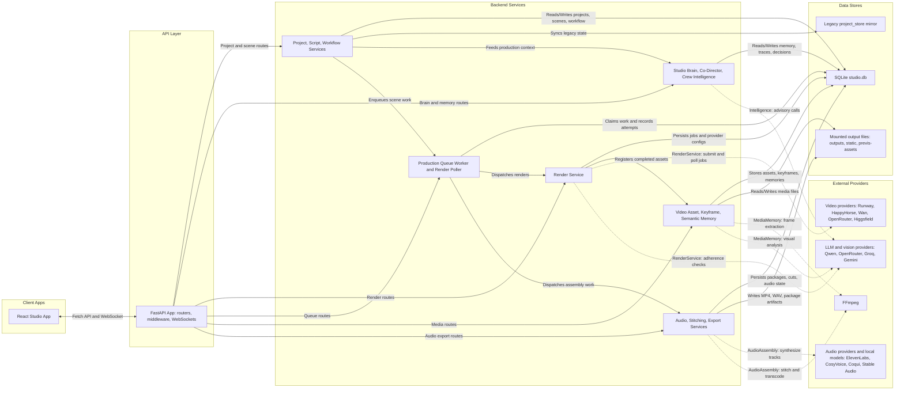

# AI Film Studio Architecture Diagram

## Notes

- The frontend resolves API calls through `STUDIO_API_BASE`; in local dev, Vite proxies `/api`, `/health`, `/outputs`, and `/previs-assets` to the FastAPI backend on port `8010`.
- The backend is a FastAPI monolith: routes stay thin and route requests into service-layer modules.
- `DatabaseStorage` owns the SQLite-backed project, render, queue, memory, media, workflow, and export tables.
- Long-running work is handled by FastAPI lifespan tasks: production queue worker, render polling, and database backup scheduling.
- External video generation is provider-adapter mediated through `RenderService`; routes should not call provider adapters directly.
